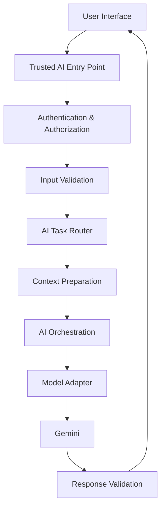
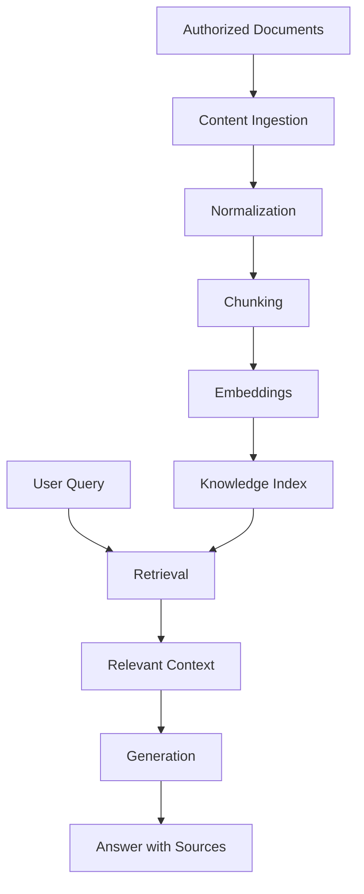

# SyncSphere — AI Modernization & Evolution Roadmap

**Project:** SyncSphere  
**Document Status:** Approved  
**Version:** 0.1  
**Document Type:** AI Architecture, Modernization & Product Evolution Roadmap  
**Approved By:** Evans Abraham  
**Approval Date:** 2026-11-28  
**Target Branch:** `agentic-development`  
**Related Documents:** Recovery Roadmap v0.3; Technical Plan v0.3; Risk Register v0.4

---

## 1. Purpose

This roadmap defines the long-term evolution of SyncSphere's AI capabilities.

SyncSphere should evolve beyond basic AI-powered text generation into an intelligent document and knowledge platform capable of understanding user content, assisting with document workflows, retrieving relevant knowledge, and delivering useful context-aware results.

This roadmap establishes a phased approach to AI modernization that prioritizes reliability, security, usefulness, maintainability, cost control, and user trust.

This is an incremental product evolution, not a rewrite or an attempt to introduce AI complexity before the existing application is stable.

## 2. Vision

Transform SyncSphere from a document editor with AI assistance into a context-aware workspace where AI can help users create, understand, organize, analyze, and work with their documents and knowledge.

AI should enhance the user's work without taking control of it.

### Product principles

- **User-controlled:** AI-generated or modified content remains reviewable and user-controlled.
- **Grounded:** Answers should use relevant source material when available and distinguish sourced information from unsupported claims.
- **Secure:** AI must respect authentication, authorization, document ownership, and workspace boundaries.
- **Reliable:** Failures must be handled gracefully without losing or silently replacing user content.
- **Purposeful:** Every AI feature must solve a genuine user problem.
- **Efficient:** Manage latency, model usage, context size, and cost.
- **Modular:** Model providers, prompts, retrieval, validation, and workflows should not be tightly coupled to UI components.
- **Incremental:** Each phase delivers measurable improvements and establishes prerequisites for the next.

## 3. Relationship to the Recovery Roadmap

AI modernization is a separate but connected engineering track.

| Track | Objective |
|---|---|
| Track A — Recovery & Product Stability | Recover, secure, stabilize, and modernize SyncSphere's existing functionality. |
| Track B — AI Modernization & Evolution | Build reliable AI foundations and progressively introduce knowledge intelligence and AI-native workflows. |

Track B must respect Track A's security and stability gates.

### Dependencies

- M1 Security & Data Integrity establishes trusted identity, access boundaries, and safe server-side AI operations.
- M2 Platform Modernization establishes a compatible and maintainable platform.
- M3 Core Application Stability includes current Gemini model and integration modernization.
- AI features depending on document persistence, editor behavior, or responsive workflows must respect their recovery milestone dependencies.

AI modernization may proceed in parallel with independent recovery tasks only when its prerequisites are satisfied and scope is approved.

## 4. Phase Overview

| Phase | Name | Primary Outcome |
|---|---|---|
| Phase 0 | Revival & Readiness | Stable, secure foundations for AI |
| Phase 1 | AI Foundation | Maintainable AI architecture and reliable generation |
| Phase 2 | RAG & Knowledge Intelligence | Context-aware, source-grounded document understanding |
| Phase 3 | AI Governance & Cost Control | Responsible usage, budgets, evaluation, and observability |
| Phase 4 | AI-Assisted Document Workflows | Practical document transformation and intelligence |
| Phase 5 | AI-Native Knowledge Workspace | Connected, proactive, user-controlled knowledge experiences |

Phases represent dependency and capability progression, not rigid calendar deadlines. Advancement is determined by acceptance criteria, evidence, and owner approval.

## 5. Phase 0 — Revival & Readiness

**Priority:** P0  
**Objective:** Establish a safe and reliable baseline before expanding AI capabilities.

### Scope

- Complete relevant security and data integrity recovery.
- Verify authenticated identity for AI requests.
- Enforce document/workspace ownership and authorization.
- Ensure AI calls are handled through trusted server-side boundaries.
- Remove any client exposure of provider secrets.
- Validate inputs and AI responses.
- Verify the current Gemini SDK, configured model, support lifecycle, and migration requirements.
- Identify current AI generation behavior, limitations, failure modes, and dependencies.
- Establish initial test coverage for the AI integration.
- Define user-visible loading, failure, retry, and success behavior.
- Protect existing document content from unintended AI overwrites.

### Deliverables

- Verified AI integration baseline.
- Documented model/SDK status and compatibility findings.
- Security-reviewed AI request flow.
- AI integration test baseline.
- Known limitations and risks.
- Approved AI modernization scope.

### Exit Criteria

- AI requests are authenticated and protected.
- Authorization is verified before accessing document context.
- API secrets remain server-side.
- Generation failures cannot silently destroy document content.
- Current AI integration and model lifecycle are understood.
- Critical AI reliability issues are resolved or formally dispositioned.

## 6. Phase 1 — AI Foundation

**Priority:** P1  
**Objective:** Create a modular, maintainable foundation that supports future AI capabilities without scattering provider logic throughout the application.

### 6.1 AI Architecture

Introduce logical AI boundaries:

- AI orchestration layer.
- Task routing.
- Model/provider adapter.
- Prompt management.
- Input and output validation.
- Context preparation.
- Error classification and handling.
- Usage and cost tracking interfaces.
- Feature-level AI service boundaries.

Avoid unnecessary microservices. The architecture should initially remain compatible with SyncSphere's existing Next.js application and trusted server-side environment.

### 6.2 Proposed AI Request Flow

### 6.3 AI Service Responsibilities

The AI layer should provide reusable functionality for:

- Task-specific model invocation.
- Prompt construction.
- Context selection and formatting.
- Response parsing and validation.
- Structured output support.
- Error normalization.
- Timeout and retry policy.
- Usage tracking.
- Model configuration.
- Feature-specific behavior.

### 6.4 Prompt Management

- Separate prompts by task.
- Avoid giant universal prompts.
- Version prompts when changes materially affect output.
- Keep system instructions separate from user-provided content.
- Treat documents and retrieved content as untrusted data.
- Avoid leaking unrelated document or user context.
- Test prompt changes against representative scenarios.

### Deliverables

- Modular AI service architecture.
- Provider/model configuration boundary.
- Centralized task routing.
- Prompt organization and versioning approach.
- Validated AI response contracts.
- Consistent AI error handling.

### Exit Criteria

- AI calls no longer require feature components to manage provider-specific implementation details.
- Tasks have explicit input/output expectations.
- Failures are consistently handled.
- Model changes can be evaluated without rewriting unrelated features.
- Regression tests cover critical AI behavior.

## 7. Phase 2 — RAG & Knowledge Intelligence

**Priority:** P1  
**Objective:** Enable SyncSphere to answer questions and perform tasks using relevant document context rather than relying solely on user prompts.

RAG (Retrieval-Augmented Generation) is introduced to allow AI to retrieve relevant information from authorized content before generating a response.

### 7.1 Knowledge Pipeline

### 7.2 Planned Capabilities

- Document content ingestion.
- Structured content normalization.
- Chunking strategies suitable for different content types.
- Embedding generation.
- Semantic retrieval.
- Relevant-context ranking.
- Context size management.
- Source references and document attribution.
- Context-aware answers.
- Retrieval quality evaluation.

### 7.3 Knowledge Sources

Initial source priority:

1. User's explicitly selected document.
2. Documents within an authorized workspace.
3. User-authorized connected knowledge sources, if introduced later.

Retrieval must enforce access control. Documents must not become accessible simply because they exist in an index.

### 7.4 Planned Knowledge Features

- Ask questions about a document.
- Ask questions across selected documents.
- Summarize collections of documents.
- Extract important concepts and key points.
- Discover related documents.
- Compare information across documents.
- Identify relevant passages and sources.

### Deliverables

- Knowledge ingestion pipeline.
- Retrieval/indexing architecture.
- Context selection and limits.
- Grounded generation workflow.
- Source attribution mechanism.
- Retrieval evaluation dataset or test cases.

### Exit Criteria

- Retrieval respects authorization boundaries.
- Relevant content is retrieved for representative queries.
- Responses can distinguish retrieved evidence from unsupported conclusions.
- Source attribution is traceable to the original document.
- Retrieval and generation failures are handled safely.
- Performance and context limits are documented.

## 8. Phase 3 — AI Governance & Cost Control

**Priority:** P1  
**Objective:** Establish sustainable AI usage, protect the service from abuse, manage costs, and maintain AI quality as capabilities expand.

### 8.1 Usage Governance

Implement controls for:

- Monthly usage budgets.
- Daily usage limits.
- Per-request limits.
- Concurrent request limits.
- Rate limiting.
- Request validation.
- Context/token budgets.
- Abuse detection.
- Usage reset policy.
- Provider error and quota handling.

### 8.2 Proposed Initial Usage Policy

The following values are an initial proposal only and are not approved or implemented.

| Control | Proposed Value |
|---|---:|
| Monthly allowance | 25,000 usage units |
| Daily allowance | 5,000 usage units |
| Per-request ceiling | 4,000 usage units |
| Concurrent requests | 1 |
| Monthly rollover | None |
| Monthly reset | Fixed monthly reset |

**Definition of usage units:** To be determined. This may represent tokens, normalized AI credits, or a weighted measure of provider cost. The policy must be finalized only after the selected model's pricing, token accounting, and feature needs are evaluated.

The values must be reviewed against actual usage, model cost, provider limits, and expected user behavior before implementation.

### 8.3 Context Management

- Limit context to relevant content.
- Avoid passing entire workspaces by default.
- Prioritize explicit user selections.
- Estimate context and request size before provider invocation.
- Define truncation or summarization strategies.
- Track context consumption.
- Protect sensitive information from unnecessary inclusion.

### 8.4 AI Quality Evaluation

Establish an evaluation process for:

- Correctness.
- Relevance.
- Groundedness.
- Completeness.
- Instruction adherence.
- Structured output validity.
- Hallucination behavior.
- Latency.
- Cost.
- Regression after prompt/model changes.

Evaluation should use representative tasks and documented expectations. Model upgrades must not be accepted based solely on novelty or benchmark claims.

### 8.5 Observability

Capture appropriate operational metrics such as:

- Request count.
- Success/failure rates.
- Latency.
- Usage consumption.
- Provider errors.
- Rate-limit events.
- Retrieval quality signals.
- Feature-level usage.

Avoid logging secrets or unnecessary user document content. Observability should be privacy-conscious and proportionate to the application.

### Deliverables

- AI usage policy.
- Budget and context management.
- Rate-limit and abuse controls.
- Evaluation methodology.
- AI operational metrics.
- Cost review process.

### Exit Criteria

- Usage controls are enforced server-side.
- Users receive clear quota and failure feedback.
- Requests cannot bypass configured budgets.
- Evaluation is repeatable.
- Cost and quality can be reviewed before major changes.

## 9. Phase 4 — AI-Assisted Document Workflows

**Priority:** P1/P2  
**Objective:** Introduce practical AI features that directly improve the user's document workflow.

Features must be individually scoped, validated, tested, and delivered incrementally.

### 9.1 Writing & Transformation

- Summarize.
- Rewrite.
- Expand.
- Simplify.
- Change tone.
- Improve clarity.
- Correct grammar.
- Generate outlines.
- Continue writing.
- Convert notes into structured content.

### 9.2 Document Intelligence

- Extract key points.
- Extract action items.
- Identify entities and topics.
- Generate titles.
- Generate descriptions.
- Create tags.
- Identify document themes.
- Produce structured summaries.
- Generate question sets from content.

### 9.3 Comparison & Analysis

- Compare documents.
- Identify differences.
- Summarize changes in meaning.
- Detect overlapping concepts.
- Highlight contradictions for user review.
- Synthesize information from multiple sources.

### 9.4 Discovery & Organization

- Recommend related documents.
- Suggest tags and categories.
- Surface relevant existing knowledge.
- Suggest links between concepts and documents.
- Help users organize collections.

### Feature Acceptance Criteria

Every AI-assisted workflow must:

- Have a clear user purpose.
- Define input and output contracts.
- Respect permissions.
- Validate responses.
- Handle failures.
- Preserve user content.
- Provide user review and control.
- Include appropriate tests.
- Demonstrate acceptable latency and cost.
- Avoid unnecessary context usage.

## 10. Phase 5 — AI-Native Knowledge Workspace

**Priority:** P2/P3  
**Objective:** Evolve SyncSphere toward an intelligent workspace where documents, knowledge, and user workflows are connected.

This phase is exploratory and dependent on the success and evaluation of earlier phases.

### Potential Capabilities

- Workspace-wide knowledge assistant.
- Context-aware assistance across selected documents.
- Knowledge graph or concept relationship exploration.
- Personalized knowledge discovery.
- Document-aware recommendations.
- Intelligent organization and linking.
- Multi-step AI workflows.
- User-approved automation.
- Proactive insights based on authorized content.
- Persistent task context where appropriate.

### Agentic Workflow Principles

Future AI workflows may execute multiple steps, but must remain bounded.

- Define explicit task scope.
- Require authorization for every relevant data operation.
- Separate planning from execution.
- Validate intermediate and final results.
- Require confirmation for destructive or consequential actions.
- Maintain transparency about actions and sources.
- Provide cancellation and failure recovery.
- Do not grant unrestricted workspace access.

### Exit Criteria

Phase 5 capabilities are individually evaluated, scoped, and approved. AI actions remain traceable, permission-bound, user-controlled, and reversible where feasible.

## 11. Proposed AI Architecture Boundaries

| Component | Responsibility |
|---|---|
| AI UI | User interactions, feedback, selection, status |
| AI Entry Point | Trusted request boundary and orchestration entry |
| Authorization | Identity, workspace/document permissions |
| Task Router | Select appropriate task/workflow |
| Context Manager | Select, bound, and prepare authorized context |
| Prompt Manager | Task instructions and prompt versions |
| Model Adapter | Provider/model interface and configuration |
| Validation | Output schema, safety, formatting, and integrity |
| Retrieval Layer | Knowledge search, ranking, source references |
| Governance Layer | Quotas, budgets, rate limits, usage accounting |
| Evaluation Layer | Quality, regressions, performance, cost |
| Observability | Operational metrics and privacy-conscious diagnostics |

These are logical boundaries. They do not require each component to be a separate package, service, or deployment.

## 12. Security & Privacy Requirements

- Authentication and authorization must be enforced server-side.
- AI must never bypass existing workspace/document access rules.
- Provider secrets must remain server-side.
- User content must be treated as untrusted input.
- Retrieved content must not be treated as trusted instructions.
- Prompt injection risks must be considered in document retrieval and AI workflows.
- Context should be limited to what the task requires.
- AI outputs must not be trusted for authorization, database mutations, or security decisions.
- Sensitive content should not be included in logs unnecessarily.
- User content must not be overwritten without clear user intent and safe recovery.
- Connected knowledge sources must have explicit permissions and scope.
- Agentic actions must use bounded, validated tools.

## 13. Dependencies & Phase Gates

| Phase | Prerequisites |
|---|---|
| Phase 0 | Recovery assessment and security foundation |
| Phase 1 | Phase 0 acceptance |
| Phase 2 | Stable AI foundation; document/data boundaries; content integrity |
| Phase 3 | AI foundation and usage instrumentation; provider cost understanding |
| Phase 4 | AI foundation; applicable retrieval/context capabilities for grounded features |
| Phase 5 | Successful earlier phases; demonstrated quality, governance, and user value |

Phases may overlap only when prerequisites are met, work is isolated, and risk is understood.

## 14. Risks & Mitigations

| Risk | Mitigation |
|---|---|
| Hallucinated information | Retrieval grounding, validation, source attribution, user review |
| Prompt injection | Treat documents as untrusted data; constrain instructions and tool permissions |
| Unauthorized retrieval | Permission-aware retrieval and access tests |
| AI provider/model changes | Model adapter, lifecycle monitoring, regression evaluation |
| Excessive costs | Budgets, quotas, context limits, rate limits |
| Poor retrieval quality | Retrieval evaluation, ranking improvements, relevant chunking |
| Latency | Context optimization, bounded workflows, performance measurement |
| Content loss | User-controlled insertion, safe updates, recovery |
| Overengineering | Phased implementation, modular monolith, evidence-driven dependencies |
| AI feature sprawl | Feature acceptance criteria and product value review |
| Privacy exposure | Minimal context, safe logging, controlled sources |
| Unreliable automation | Bounded actions, validation, confirmations, auditability |

## 15. Engineering Workflow

Each AI work package follows this process:

1. Define the user problem and scope.
2. Define input/output contracts and acceptance criteria.
3. Identify security, privacy, cost, and failure risks.
4. Inspect existing architecture and dependencies.
5. Design the smallest appropriate implementation.
6. Implement with tests-first where practical.
7. Evaluate outputs against representative cases.
8. Verify failure, timeout, and recovery behavior.
9. Review performance, cost, and maintainability.
10. Document decisions and limitations.
11. Commit a logical, verified change.
12. Obtain owner acceptance when required.

No AI feature is considered complete solely because it produces a successful response in a happy-path demonstration.

## 16. Out of Scope Unless Separately Approved

- Autonomous destructive document operations.
- Unrestricted AI access to the entire workspace.
- Automatic publishing or sharing.
- Unreviewed AI content replacement.
- Independent AI agents with unbounded permissions.
- Unnecessary external microservices.
- Paid provider/service commitments without approval.
- Large-scale data migrations.
- AI-generated decisions that replace user control.

## 17. Success Criteria

AI modernization is successful when SyncSphere:

- Has a secure, maintainable, modular AI foundation.
- Uses supported and documented model configurations.
- Produces reliable and validated outputs.
- Understands authorized document context.
- Provides source-grounded knowledge answers when retrieval is used.
- Offers useful document workflows beyond basic generation.
- Enforces cost, context, rate, and usage controls.
- Evaluates quality and regressions systematically.
- Handles AI failures without losing user content.
- Remains user-controlled, privacy-conscious, and maintainable.
- Demonstrates measurable value from each delivered AI capability.

## 18. Roadmap Maintenance

This roadmap is expected to evolve as SyncSphere's recovery, usage patterns, AI provider capabilities, cost data, evaluation results, and product priorities become clearer.

Phase scope, acceptance criteria, budgets, and architecture may be refined based on evidence.

Material scope expansions, new paid services, privacy/security implications, destructive operations, or changes to user-control principles require Project Owner approval.

---

**End of AI Modernization & Evolution Roadmap — Version 0.1 — Approved by Evans Abraham — 2026-11-28**
