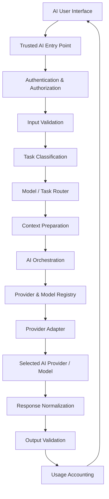
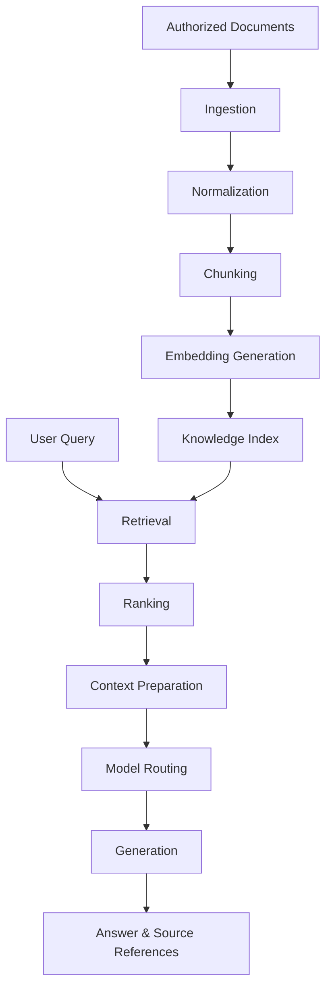

# SyncSphere — AI Modernization & Evolution Roadmap

**Project:** SyncSphere  
**Document Status:** Approved  
**Version:** 0.2  
**Document Type:** AI Architecture, Modernization & Product Evolution Roadmap  
**Approved By:** Evans Abraham  
**Approval Date:** 2026-11-28  
**Target Branch:** `agentic-development`  
**Supersedes:** AI Modernization Roadmap v0.1  
**Related Documents:** Recovery Roadmap v0.4; Technical Plan v0.4; Risk Register v0.5

---

## 1. Purpose

This roadmap defines the direction for evolving SyncSphere's AI capabilities from basic AI-assisted document functionality into a context-aware, intelligent document and knowledge workspace.

It establishes the architecture, model strategy, usage allocation policy, capability milestones, reliability expectations, and security boundaries for future AI development.

The roadmap is intended to be a living engineering document. It establishes the currently agreed direction without prematurely deciding every implementation detail. Future changes may be proposed, reviewed, and approved as new requirements or evidence emerge.

AI modernization is an incremental evolution of SyncSphere—not a rewrite or an excuse to introduce unnecessary infrastructure.

## 2. Vision

Evolve SyncSphere into an intelligent document workspace capable of helping users create, understand, transform, analyze, retrieve, and organize knowledge through reliable AI assistance.

AI should augment the user's work while preserving user control, document integrity, privacy, and transparency.

### Product Principles

- **User-controlled:** AI-generated and modified content remains reviewable and controlled by the user.
- **Grounded:** Responses should use relevant source material when available and distinguish evidence from unsupported conclusions.
- **Secure:** Authentication, authorization, ownership, and workspace boundaries must be enforced.
- **Reliable:** AI failures must not silently destroy, replace, or corrupt user content.
- **Model-flexible:** SyncSphere must not be unnecessarily tied to one AI provider or model.
- **Purposeful:** Every AI capability should address a genuine user need.
- **Efficient:** Model selection, context usage, latency, and costs should be managed.
- **Incremental:** Capabilities are introduced through measurable milestones and acceptance criteria.

## 3. Relationship to Product Recovery

AI Modernization is a separate but connected engineering track.

| Track | Objective |
|---|---|
| Track A — Recovery & Product Stability | Secure, recover, stabilize, and modernize existing application functionality. |
| Track B — AI Modernization & Evolution | Establish a flexible AI foundation and progressively introduce intelligent document and knowledge capabilities. |

AI work must respect the security, data integrity, and stability requirements of the recovery track.

AI features that depend on document persistence, editor behavior, authentication, or workspace permissions must not bypass their corresponding recovery requirements.

Independent AI architecture work may proceed only when prerequisites are satisfied and scope is approved.

## 4. AI Modernization Phases

| Phase | Name | Primary Outcome |
|---|---|---|
| Phase 0 | Revival & Readiness | A secure and understood AI baseline |
| Phase 1 | AI Foundation & Multi-Model Architecture | Provider-flexible architecture, model tiers, routing, and reliability |
| Phase 2 | RAG & Knowledge Intelligence | Context-aware and source-grounded document intelligence |
| Phase 3 | AI Governance & Cost Control | Usage accounting, limits, quality evaluation, and cost observability |
| Phase 4 | AI-Assisted Document Workflows | Practical AI-powered document operations |
| Phase 5 | AI-Native Knowledge Workspace | Connected, intelligent, bounded, user-controlled workflows |

Phases describe dependency progression rather than fixed calendar dates. Advancement requires acceptance criteria, evidence, and project owner review.

## 5. Phase 0 — Revival & Readiness

**Priority:** P0  
**Objective:** Establish a safe and reliable baseline before expanding AI functionality.

### Scope

- Inspect the existing AI integration and its implementation.
- Verify the SDK, API, configured model, and model lifecycle/support status.
- Identify current generation features, limitations, and failure modes.
- Verify authentication and authorization for AI requests.
- Ensure provider secrets remain server-side.
- Verify document and workspace permissions before context access.
- Validate request inputs and AI outputs.
- Review failure, loading, retry, and success behavior.
- Protect document content against unintended AI overwrites.
- Establish test coverage for the existing AI functionality.
- Identify dependencies for AI modernization.

### Deliverables

- Documented AI integration baseline.
- Model and SDK lifecycle assessment.
- Security-reviewed AI request flow.
- AI test baseline.
- Identified defects, limitations, and risks.
- Approved modernization scope.

### Exit Criteria

- AI requests are appropriately authenticated and authorized.
- Provider secrets are not exposed to clients.
- Existing AI behavior is understood.
- Critical reliability issues are resolved or dispositioned.
- User content is protected against unintended changes.
- The foundation for AI modernization is approved.

## 6. Phase 1 — AI Foundation & Multi-Model Architecture

**Priority:** P1  
**Objective:** Establish a flexible AI architecture that supports multiple models, intelligent task routing, user-selectable model tiers, and consistent provider-independent behavior.

### 6.1 Multi-Provider Architecture

SyncSphere should support a provider-independent AI architecture.

The application must avoid embedding provider-specific API calls, model assumptions, prompt handling, or response parsing directly into feature components.

### Logical Components

- AI orchestration layer.
- AI task router.
- Provider registry.
- Model registry and configuration.
- Provider/model adapters.
- Prompt management.
- Context management.
- Input/output validation.
- Error normalization.
- Retry and timeout policies.
- Usage accounting interfaces.
- Feature-specific AI services.

These are logical boundaries and do not mandate separate services, deployments, or microservices.

### 6.2 Model Tiers

SyncSphere will provide three user-facing AI tiers.

#### Lite

Designed for routine, lower-complexity, cost-efficient AI tasks.

**Initially discussed model:** Gemini 3.5 Flash-Lite.

Typical use cases:

- Basic summaries.
- Simple rewrites.
- Tagging and classification.
- Short-form extraction.
- Straightforward document questions.
- Routine content transformations.

The model selection remains configurable and subject to availability, lifecycle support, evaluation, and cost.

#### Balanced / Auto

Designed to automatically select an appropriate model for a task.

Auto routing should consider factors such as:

- Task type.
- Complexity.
- Required reasoning.
- Context length.
- Structured-output requirements.
- Expected latency.
- Model availability.
- Cost.
- User preference.

The purpose is to avoid unnecessarily using advanced models for routine work while allowing more capable models when a task warrants them.

Balanced / Auto is a routing strategy, not necessarily one fixed model.

#### Advanced

Designed for more demanding AI tasks where stronger reasoning or quality is justified.

**Initially discussed model:** Gemini 3.8 Flash.

Typical use cases:

- Complex document analysis.
- Multi-document synthesis.
- Nuanced writing and transformations.
- Detailed comparisons.
- Higher-complexity reasoning tasks.

Model assignments must be evaluated before implementation and may evolve as supported models, costs, and capabilities change.

### 6.3 Model & Provider Abstraction

The architecture should support:

- Provider-independent task interfaces.
- Model configuration independent of feature components.
- Model capability metadata.
- Task-to-model routing.
- User tier preferences.
- Per-request overrides where supported.
- Consistent response contracts.
- Provider-independent error handling.
- Model lifecycle replacement without rewriting unrelated features.

Additional providers may be incorporated in the future when justified and approved. This roadmap does not establish an unconfirmed provider roster.

### 6.4 AI Request Flow

### 6.5 Reliability & Provider Handling

The AI architecture should establish consistent handling for:

- Timeouts.
- Retryable and non-retryable errors.
- Rate limiting and HTTP 429 responses.
- Provider outages.
- Model unavailability or retirement.
- Malformed responses.
- Invalid structured output.
- Context-length errors.
- Failed routing.
- Fallback behavior where permitted.

Retries must be bounded and must not produce uncontrolled usage or duplicate consequential operations.

Fallback behavior must respect user tier, feature requirements, usage limits, and cost policy. A fallback must not silently downgrade a task when doing so materially changes expected quality or behavior.

Circuit-breaker behavior and additional resilience mechanisms may be introduced when justified by the implementation.

### Deliverables

- AI orchestration boundary.
- Provider/model registry and adapters.
- Model tier definitions.
- Task routing architecture.
- Prompt organization and versioning.
- Validated response contracts.
- Normalized error handling.
- Reliability policy.
- AI integration tests.

### Exit Criteria

- Feature components are not tightly coupled to provider-specific implementations.
- Model changes can be made without unrelated feature rewrites.
- Tier selection and Auto routing follow explicit policies.
- AI failures are normalized and handled consistently.
- Structured outputs are validated.
- Critical AI behaviors are covered by tests.
- Routing, provider handling, and configuration can be maintained independently.

## 7. Phase 2 — RAG & Knowledge Intelligence

**Priority:** P1  
**Objective:** Allow AI to answer questions and perform document tasks using relevant, authorized source content.

RAG (Retrieval-Augmented Generation) enables SyncSphere to retrieve relevant information before generation, reducing dependence on prompts alone and enabling traceable answers.

### 7.1 Knowledge Pipeline

### 7.2 Planned Capabilities

- Document ingestion.
- Content normalization.
- Appropriate chunking.
- Embedding generation.
- Semantic retrieval.
- Relevant-context ranking.
- Context-size management.
- Source attribution.
- Retrieval evaluation.
- Grounded answers.

### 7.3 Knowledge Sources

Initial source priority:

1. Explicitly selected documents.
2. Documents within an authorized workspace.
3. Future connected knowledge sources, if separately approved and integrated.

Retrieval must enforce access control. Indexed content must not become accessible merely because it exists in a knowledge index.

### 7.4 Knowledge Features

- Ask questions about individual documents.
- Ask questions across selected documents.
- Summarize document collections.
- Extract concepts and key points.
- Discover related documents.
- Compare information.
- Identify relevant passages.
- Produce source-grounded responses.

### Deliverables

- Ingestion pipeline.
- Retrieval/indexing architecture.
- Context selection and limits.
- Grounded generation.
- Source attribution.
- Retrieval test cases.

### Exit Criteria

- Retrieval respects authorization boundaries.
- Representative queries retrieve relevant content.
- Source references are traceable.
- Answers distinguish retrieved information from unsupported conclusions.
- Retrieval failures are handled safely.
- Performance and context limits are documented.

## 8. Phase 3 — AI Governance & Cost Control

**Priority:** P1  
**Objective:** Establish sustainable AI usage, allocation enforcement, provider-cost visibility, and quality evaluation.

### 8.1 User AI Allocation Policy

The latest discussed baseline supersedes the original allocation proposal from v0.1.

| Control | Revised Baseline |
|---|---:|
| Monthly user allocation | 25,000 tokens |
| Daily allocation cap | None |
| Maximum allocation per request | 2,000 tokens |
| Concurrent AI requests | 1 |
| Reset period | Monthly |
| Rollover | None |

The daily cap is intentionally removed. The maximum request allowance is reduced from the previous proposal of 4,000 to 2,000.

This is the current roadmap policy direction. Server-side enforcement and accounting are not yet implemented merely by documenting these values.

### 8.2 Allocation Reset & Enforcement

The implementation must define and enforce:

- Monthly reset behavior.
- Consistent reset timing.
- Allocation reservation and settlement.
- Failed-request handling.
- Usage reconciliation.
- Concurrent request enforcement.
- Request ceiling enforcement.
- No rollover.
- Protection against quota bypass.
- Clear user feedback when limits are reached.

The reset schedule and exact accounting implementation must be finalized before implementation.

### 8.3 Separate User Allocation from Provider Usage

SyncSphere must distinguish its user-facing allocation from actual provider consumption and expense.

Three distinct measurements are required:

1. **User allocation / credits** — the amount deducted from a user's monthly allowance.
2. **Provider token usage** — actual input and output tokens reported or measured for each provider/model request.
3. **Provider cost** — the estimated or actual monetary cost incurred by SyncSphere.

These values must not be assumed to be interchangeable.

### 8.4 Model-Weighted Accounting

Different models and tasks may have different provider costs.

A future accounting mechanism may assign weighted user-credit consumption according to factors such as:

- Input tokens.
- Output tokens.
- Model pricing.
- Task type.
- Provider costs.
- Additional supported modalities or processing.

The exact credit conversion ratios and weighting formulas remain pending benchmarking and cost evaluation.

No final conversion formula is established by this roadmap.

### 8.5 Context & Usage Management

- Limit context to relevant content.
- Avoid passing entire workspaces by default.
- Prioritize explicit document selections.
- Estimate request size before provider invocation.
- Define safe truncation or summarization.
- Track context consumption.
- Protect sensitive information from unnecessary inclusion.
- Respect provider/model-specific context limits.
- Account for output-token ceilings.

### 8.6 AI Quality Evaluation

Evaluate AI outputs for:

- Correctness.
- Relevance.
- Groundedness.
- Completeness.
- Instruction adherence.
- Structured-output validity.
- Hallucination behavior.
- Latency.
- Cost.
- Regression across model or prompt changes.

Model upgrades must not be accepted solely because they are newer or claim higher benchmarks.

### 8.7 Observability

Capture proportionate, privacy-conscious metrics:

- Request volume.
- Success/failure rates.
- Latency.
- Provider/model selection.
- Input/output token consumption.
- User allocation consumption.
- Provider cost.
- Provider errors.
- Rate-limit events.
- Routing and fallback events.
- Retrieval quality signals.
- Feature-level usage.

Avoid logging secrets or unnecessary document contents.

### Deliverables

- Enforced monthly allocation.
- Request and concurrency limits.
- No-rollover policy.
- User allocation accounting.
- Provider token and cost tracking.
- Model-weighted consumption policy.
- Evaluation methodology.
- Cost and usage observability.
- Clear quota and failure feedback.

### Exit Criteria

- Allocation is enforced server-side.
- Requests cannot bypass budgets.
- Usage is accounted for consistently.
- Provider costs can be measured or reasonably estimated.
- Model tiers have measurable cost/quality profiles.
- Users receive clear limit and failure feedback.
- Evaluation is repeatable.

## 9. Phase 4 — AI-Assisted Document Workflows

**Priority:** P1/P2  
**Objective:** Deliver useful AI workflows that improve document creation, transformation, understanding, and organization.

Features must be independently scoped, validated, tested, and delivered incrementally.

### 9.1 Writing & Transformation

- Summarize.
- Rewrite.
- Expand.
- Simplify.
- Change tone.
- Improve clarity.
- Correct grammar.
- Generate outlines.
- Continue writing.
- Convert notes into structured content.

### 9.2 Document Intelligence

- Extract key points.
- Extract action items.
- Identify entities and topics.
- Generate titles.
- Generate descriptions.
- Create tags.
- Identify themes.
- Produce structured summaries.
- Generate questions from content.

### 9.3 Comparison & Analysis

- Compare documents.
- Identify differences.
- Summarize meaning changes.
- Detect overlapping concepts.
- Highlight contradictions for review.
- Synthesize information across sources.

### 9.4 Discovery & Organization

- Recommend related documents.
- Suggest tags and categories.
- Surface existing knowledge.
- Suggest concept/document links.
- Help organize collections.

### Feature Acceptance Criteria

Every AI workflow must:

- Have a clear user purpose.
- Define input/output contracts.
- Respect permissions.
- Use appropriate model routing.
- Validate responses.
- Handle failures.
- Preserve user content.
- Provide user review and control.
- Include tests.
- Demonstrate acceptable latency and cost.
- Avoid unnecessary context usage.

## 10. Phase 5 — AI-Native Knowledge Workspace

**Priority:** P2/P3  
**Objective:** Evolve SyncSphere toward an intelligent workspace where documents, knowledge, and workflows are connected.

This phase is exploratory and dependent on earlier phases demonstrating reliability, security, quality, and value.

### Potential Capabilities

- Workspace-wide knowledge assistant.
- Context-aware assistance across selected documents.
- Concept and relationship exploration.
- Personalized knowledge discovery.
- Document-aware recommendations.
- Intelligent organization and linking.
- Multi-step AI workflows.
- User-approved automation.
- Proactive insights using authorized content.
- Persistent task context where appropriate.

### Agentic Workflow Principles

Future AI workflows must remain bounded and user-controlled.

- Define explicit task scope.
- Enforce authorization for each relevant data operation.
- Separate planning from execution.
- Validate intermediate and final results.
- Require confirmation for destructive or consequential actions.
- Maintain transparency about actions and sources.
- Provide cancellation and recovery.
- Avoid unrestricted workspace access.

### Exit Criteria

Each Phase 5 capability is separately evaluated and approved. AI actions remain permission-bound, traceable, user-controlled, and reversible where feasible.

## 11. Proposed AI Architecture Boundaries

| Component | Responsibility |
|---|---|
| AI UI | User interactions, tier selection, preferences, feedback, status |
| AI Entry Point | Trusted request boundary |
| Authorization | Identity, document/workspace permissions |
| Task Classifier | Determine task type and requirements |
| AI Task Router | Route tasks to appropriate tier/workflow |
| Model Registry | Model definitions, capabilities, configuration, lifecycle |
| Provider Registry | Available providers and adapters |
| Orchestration | Coordinate AI requests and workflow execution |
| Context Manager | Select, bound, and prepare authorized context |
| Prompt Manager | Task instructions and prompt versions |
| Validation | Output schema, safety, formatting, integrity |
| Retrieval Layer | Search, ranking, knowledge references |
| Governance Layer | Quotas, budgets, concurrency, rate limits |
| Accounting | User credits, provider tokens, provider cost |
| Evaluation Layer | Quality, regression, performance |
| Observability | Metrics, diagnostics, privacy-conscious logs |

These are logical architecture boundaries. They do not mandate separate packages, services, or deployment infrastructure.

## 12. Security & Privacy Requirements

- Enforce authentication and authorization server-side.
- Never bypass document or workspace access rules.
- Keep provider credentials server-side.
- Treat user content as untrusted input.
- Treat retrieved content as untrusted data, not instructions.
- Account for prompt injection.
- Limit context to task requirements.
- Never trust AI output for authorization or security decisions.
- Avoid unnecessary sensitive information in logs.
- Protect user content against unintended overwrites.
- Require explicit permissions for connected sources.
- Use bounded and validated tools for future agentic workflows.
- Ensure model routing and fallback cannot bypass usage or security policies.

## 13. Dependencies & Phase Gates

| Phase | Prerequisites |
|---|---|
| Phase 0 | Recovery assessment and security foundation |
| Phase 1 | Phase 0 acceptance |
| Phase 2 | Stable AI foundation, document boundaries, integrity |
| Phase 3 | AI foundation, usage instrumentation, model/provider cost understanding |
| Phase 4 | AI foundation; retrieval/context where needed |
| Phase 5 | Successful earlier phases, quality, governance, and user value |

Phases may overlap only when prerequisites are met, work is isolated, and risks are understood.

## 14. Risks & Mitigations

| Risk | Mitigation |
|---|---|
| Hallucinations | Grounding, validation, sources, user review |
| Prompt injection | Treat documents as untrusted; constrain instructions and permissions |
| Unauthorized retrieval | Permission-aware retrieval and access testing |
| Provider/model lifecycle changes | Registry, adapters, lifecycle monitoring, evaluations |
| Model routing errors | Explicit routing policies, validation, safe fallbacks |
| Provider outages | Bounded retries, error normalization, availability handling |
| Excessive costs | Allocation, budgets, context limits, concurrency, cost tracking |
| Allocation/accounting mismatch | Reconciliation, explicit conversion rules, usage tests |
| Poor retrieval | Retrieval evaluation, ranking and chunking improvements |
| Latency | Context optimization, appropriate model tier, bounded workflows |
| Content loss | User-controlled insertion, safe updates, recovery |
| Overengineering | Modular monolith, phased delivery, evidence-driven design |
| AI feature sprawl | Acceptance criteria and product value review |
| Privacy exposure | Minimal context, safe logging, controlled sources |
| Unreliable automation | Bounded actions, validation, confirmation, auditability |

## 15. Engineering Workflow

Every AI work package follows this workflow:

1. Define the user problem and scope.
2. Define input/output contracts and acceptance criteria.
3. Identify security, privacy, cost, and failure risks.
4. Inspect existing architecture and dependencies.
5. Design the smallest appropriate implementation.
6. Implement tests-first where practical.
7. Evaluate outputs against representative cases.
8. Verify failure, timeout, and recovery behavior.
9. Review performance, cost, and maintainability.
10. Document decisions and limitations.
11. Commit a logical, verified change.
12. Obtain owner acceptance where required.

An AI feature is not complete solely because it produces a successful response in a happy-path demonstration.

## 16. Out of Scope Unless Separately Approved

- Autonomous destructive document operations.
- Unrestricted AI access to the entire workspace.
- Automatic publishing or sharing.
- Unreviewed AI content replacement.
- Unbounded independent AI agents.
- Unnecessary microservices.
- Paid provider commitments without approval.
- Large-scale data migrations.
- AI decisions replacing user control.
- Unconfirmed provider additions.
- Implementation of allocation policy without validated accounting design.

## 17. Success Criteria

AI modernization is successful when SyncSphere:

- Has a secure, modular, multi-model-capable AI foundation.
- Supports model tiers and appropriate task routing.
- Can evolve providers/models without unrelated feature rewrites.
- Uses supported model configurations.
- Produces reliable, validated outputs.
- Understands authorized document context.
- Provides grounded answers with sources when retrieval is used.
- Offers practical AI document workflows.
- Enforces allocation, request, concurrency, context, and cost controls.
- Distinguishes user allocation from provider token usage and monetary cost.
- Evaluates quality and regressions systematically.
- Handles failures without losing user content.
- Remains user-controlled, privacy-conscious, and maintainable.
- Demonstrates measurable value from each delivered capability.

## 18. Roadmap Maintenance

This is a living roadmap.

It records the currently agreed direction and leaves implementation details open until they are justified by engineering investigation, benchmarking, testing, and product requirements.

Future revisions may refine model assignments, providers, allocation accounting, acceptance criteria, phases, or architecture.

Material scope expansions, paid services, privacy/security implications, destructive operations, and changes to user-control principles require Project Owner approval.

No implementation is authorized solely by the existence of a roadmap entry.

---

**End of AI Modernization & Evolution Roadmap — Version 0.2 — Approved by Evans Abraham — 2026-11-28**
