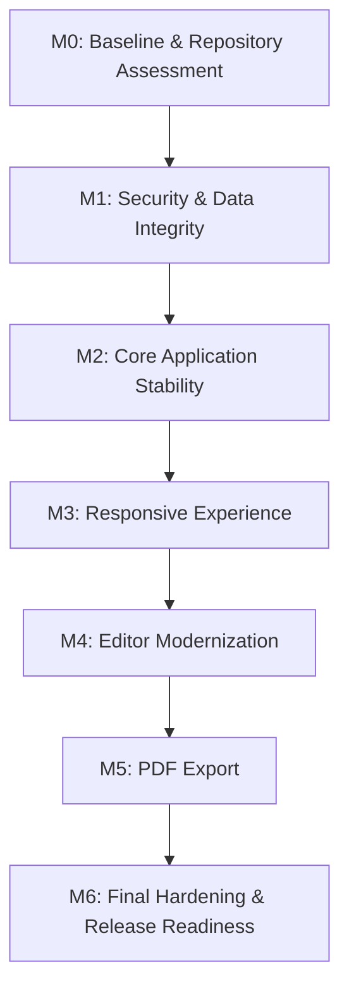

# Recovery Roadmap

**Project:** SyncSphere  
**Document Status:** Approved  
**Version:** 0.1  
**Document Type:** Recovery & Modernization Roadmap  
**Approved By:** Evans Abraham (Project Owner)  
**Target Branch:** `agentic-development`  
**Parent Documents:** Project Charter v0.2; Product Requirements v0.1

---

## 1. Purpose

This roadmap defines the order and gates for recovering, stabilizing, securing, and modernizing SyncSphere. Work is incremental and evidence-driven, preserving existing product functionality while reducing risk. This is a recovery project—not a greenfield rewrite.

## 2. Recovery Principles

- **Stabilize before expanding:** resolve critical security and data-integrity risks before dependent feature work.
- **Understand before changing:** inspect affected behavior and establish a baseline first.
- **Preserve functionality:** avoid removing existing capabilities without documented justification and owner approval.
- **Incremental recovery:** use small, reviewable work packages rather than broad rewrites.
- **Test as we go:** add appropriate tests and regression coverage with changes.
- **Evidence-based gates:** milestone completion requires documented verification, not assumptions.
- **Owner authority:** scope and release decisions remain with the project owner.

## 3. Priority Definitions

| Priority | Meaning |
| --- | --- |
| P0 | Security, data integrity, or critical stability issue |
| P1 | Core product workflow or reliability requirement |
| P2 | Quality, responsive experience, or feature refinement |
| P3 | Advanced or future enhancement |

Priority does not override dependencies, risk, or approval gates.

## 4. Milestone Overview

Milestones are sequenced by dependencies. Independent, approved work may proceed in parallel only when it does not undermine a gate or introduce conflicting risk.

## 5. Milestones

### M0 — Baseline & Repository Assessment

**Objective:** Establish a truthful baseline of the codebase, behavior, tooling, and risks before recovery implementation.

**Scope:**
- Inspect repository structure, application entry points, dependencies, scripts, and configuration.
- Review authentication and authorization flows.
- Trace Firestore reads, writes, subscriptions, and deletion behavior.
- Review Editor.js initialization, persistence, lifecycle, and cleanup.
- Inspect Gemini integration and secret exposure risks.
- Inventory workspace/document CRUD and current UI behavior.
- Assess responsive/mobile limitations.
- Inspect CI/deployment configuration without making production changes.
- Attempt baseline tests, lint, and build, recording missing scripts/configuration and failures.

**Deliverables:**
- Baseline findings and feature inventory.
- Critical issue and risk classification.
- Regression-risk notes and initial prioritized work backlog.
- Honest baseline verification report.

**Exit criteria:**
- Relevant architecture and workflows are understood sufficiently for scoped work.
- Existing behavior and significant risks are documented.
- Baseline checks have been attempted and results recorded.
- P0 issues and major unknowns are identified.

**Gate:** No implementation work begins in an area until that area has been adequately inspected; unresolved unknowns are made explicit.

### M1 — Security & Data Integrity (P0)

**Objective:** Address critical security weaknesses and protect user/workspace/document data.

**Scope:**
- Verify Clerk identity and server-side authentication.
- Ensure workspace membership/ownership and document authorization are checked server-side.
- Audit Firestore security rules and confirm effective access boundaries.
- Remove exposed client-side Gemini credentials and move AI calls to server-side routes or approved server modules.
- Validate AI inputs and outputs.
- Add abuse/rate-limit controls appropriate to AI endpoints.
- Review unsafe database access, sensitive error exposure, and environment/config mismatches.

**Exit criteria:**
- Authentication and authorization boundaries are verified and tested.
- No Gemini secret is exposed in client bundles.
- AI access is server-side and validated.
- Critical Firestore/access-control weaknesses are resolved or explicitly contained.
- Security-focused tests pass for the completed scope.
- No unresolved known critical blocker remains in the completed scope.

**Gate:** Critical security and data-integrity risks block dependent feature work.

### M2 — Core Application Stability (P0/P1)

**Objective:** Make core workspace/document workflows and persistence dependable.

**Scope:**
- Stabilize workspace and document CRUD.
- Correct editor initialization and teardown lifecycle.
- Ensure Firestore listener cleanup.
- Address save timing, debouncing/queueing, and stale-write protection.
- Handle partial failures and duplicate submissions.
- Improve loading, error, and empty states.
- Evaluate offline/recovery behavior and content preservation.
- Resolve stale references and add regression tests.

**Exit criteria:**
- Core workflows are verified end-to-end within the available test environment.
- Editor and listener lifecycles are controlled.
- Save failures are surfaced and user content is preserved.
- Stale writes and duplicate actions are controlled.
- Destructive operations have appropriate safeguards.
- Critical regression tests pass.

**Gate:** Core persistence and workflows must be stable before editor enhancements or dependent work.

### M3 — Responsive Experience (P1/P2)

**Objective:** Make the existing application usable on mobile, tablet, and desktop without regressing larger screens.

**Scope:**
- Workspace and document navigation.
- Editor layout and toolbar behavior.
- Touch-friendly controls and dialogs/menus.
- Wide content such as tables.
- Viewport, scrolling, and overflow handling.
- Accessibility and responsive interaction patterns.

**Representative viewport widths:** 320px, 375–430px, 768px, 1024px, 1440px and larger.

**Exit criteria:**
- No unintended horizontal overflow in core flows.
- Mobile navigation and editing are usable.
- Controls are touch-accessible.
- Dialogs and menus fit and behave appropriately.
- Desktop experience remains intact.
- Responsive core workflows have been verified.

**Gate:** Responsive foundations are checked before final editor-toolbar enhancements.

### M4 — Editor Modernization (P1/P2)

**Objective:** Improve editing capability and usability while preserving document integrity and compatibility.

**Scope:**
- Stabilize Editor.js lifecycle and persistence.
- Reliable autosave and clear save state.
- Formatting support: headings, paragraphs, lists/checklists, quotes, code, separators, links, images, tables, and alignment as supported.
- Undo/redo and keyboard shortcuts where supported and justified.
- Responsive toolbar and controls.
- Validation and compatibility of existing document content.
- Handling of malformed or unsupported content without losing user data.

**Exit criteria:**
- Agreed formatting scope works and persists.
- Existing documents remain readable and editable.
- Editor lifecycle and save-state behavior are stable.
- Save failures preserve content and communicate status.
- Mobile and desktop editing are verified.
- Regression coverage is updated.

**Gate:** Stable, structured content is required before PDF-export implementation.

### M5 — PDF Export (P1/P2)

**Objective:** Provide a dependable export of documents into readable PDFs.

**Scope:**
- Generate PDFs from structured document content rather than a screenshot.
- Preserve selectable/searchable text where feasible.
- Support relevant headings, formatting, lists, code, quotes, tables, and images.
- Define page size, margins, pagination, and typography; default to A4 with sensible margins unless technical evaluation or requirements justify another choice.
- Prevent clipping and awkward page breaks.
- Use document-derived filenames.
- Provide progress/error feedback and handle empty, malformed, or unsupported content.
- Keep output independent of editor viewport size.

**Exit criteria:**
- Export and download works.
- Text remains selectable where feasible.
- Supported formatting, images, and tables render correctly.
- Pagination is readable and does not clip content.
- Export is independent of viewport layout.
- Representative documents and error cases are tested.

**Gate:** PDF export must not compromise editor, data integrity, or security.

### M6 — Final Hardening & Release Readiness (P1)

**Objective:** Validate the integrated product and establish evidence-based readiness for a release.

**Scope:**
- Regression testing across authentication, authorization, CRUD, AI security, editor persistence, responsive behavior, and PDF export.
- Review dependencies, environment configuration, and secrets.
- Verify CI and required checks.
- Recheck build, lint, tests, accessibility, and error/loading states.
- Update setup and project documentation.
- Record remaining known issues, limitations, and release risks.
- Review deployment readiness without deploying to production absent explicit approval.

**Exit criteria:**
- P0/P1 work is completed or dispositioned with owner approval.
- Critical blockers are resolved.
- Core regression checks pass.
- Test, lint, and build results are recorded accurately.
- Responsive experience and PDF export are verified.
- CI checks are functioning.
- Documentation reflects actual behavior.
- Known limitations are disclosed.
- Project owner completes final review.

**Gate:** Release readiness does not imply deployment permission. Production deployment requires explicit project-owner authorization.

## 6. Dependency Rules

The intended recovery sequence is M0 → M1 → M2 → M3 → M4 → M5 → M6.

- M0 assessment precedes recovery implementation in the relevant areas.
- Critical M1 security issues block dependent work.
- M2 persistence and core workflows must be stable before editor modernization.
- Responsive foundations are addressed before final toolbar/editor refinements.
- M4 provides stable content behavior for M5 PDF export.
- M6 validates the integrated system.

Approved independent tasks may overlap only if their dependencies and risks are understood and they do not bypass a milestone gate.

## 7. Execution Strategy

Milestones are decomposed into small work packages. Each work package follows this lifecycle:

1. Define scope, acceptance criteria, dependencies, and risks.
2. Inspect the affected code and behavior.
3. Implement with appropriate TDD (RED → GREEN → REFACTOR) and regression tests.
4. Run relevant verification and record results.
5. Review scope and code, document any decisions/limitations, and commit logically.

Work packages should remain bounded. Failures must be resolved or explicitly dispositioned; verification is not reported as passed unless it actually ran and passed. Avoid unnecessary rewrites, dependencies, and scope expansion.

## 8. Initial Risk Map

| Risk | Severity | Mitigation |
| --- | --- | --- |
| Gemini credential exposed to client | Critical | Move AI calls server-side; verify bundles and configuration |
| Firestore rules unverified | Critical | Audit rules and test access boundaries |
| Unauthorized workspace/document access | Critical | Server-side ownership/membership checks and tests |
| Editor lifecycle instability | High | Correct initialization/teardown and regression tests |
| Firestore listener leaks | High | Ensure lifecycle cleanup |
| Save races or stale writes | High | Debouncing/coordination and consistency controls |
| Partial CRUD failures | High | Validation, consistent operations, clear recovery |
| Malformed AI output | High | Validate and safely handle generated content |
| Mobile usability issues | Medium | Responsive layout and interaction checks |
| PDF layout/formatting issues | Medium | Representative export validation |
| Regressions during recovery | High | Incremental changes and regression suite |

Severity may be refined after baseline assessment; risk treatment should be evidence-driven.

## 9. Change Control

Changes requiring owner review and approval include:
- Significant scope additions or removals.
- Feature removal or behavioral changes that break compatibility.
- Framework or major architectural changes.
- Breaking data-model changes or migrations.
- Changes to milestone goals or gates.
- New cost-bearing external services.
- Material security, privacy, or data-loss risk.

Minor implementation choices within the approved scope may be made by the agent, with rationale documented where useful. If the scope or risk materially changes, pause and seek approval before proceeding.

## 10. Milestone Completion Definition

A milestone is considered complete when:
- Its work packages meet their acceptance criteria.
- Appropriate tests and regression checks pass.
- Changes have been reviewed for scope, security, and data integrity.
- Documentation and relevant decisions are updated.
- Known limitations and risks are recorded.
- Verification is reported honestly.
- The owner accepts the milestone where a gate requires acceptance.

## 11. Recovery Completion

SyncSphere recovery is considered complete when:
- Authentication and access boundaries are verified.
- Core workspace/document workflows are reliable.
- Editing and persistence are dependable.
- Agreed formatting capabilities work.
- Responsive usability is verified.
- PDF export meets the defined acceptance criteria.
- AI integration is secured and validated.
- Required tests, lint, build, and CI checks are verified.
- Documentation and known limitations are current.
- The project owner approves the recovery completion.

## 12. Roadmap Maintenance

This roadmap may be adjusted as baseline findings, feasibility, dependencies, or risks become clearer. Routine sequencing adjustments within the approved scope do not require separate approval. Material changes to scope, milestones, gates, or project direction require owner review and approval.

---

**End of Recovery Roadmap — Version 0.1 — Approved**
