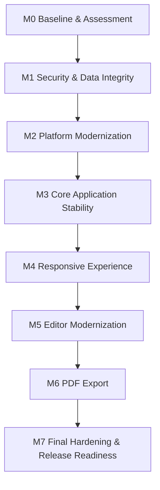

# Recovery Roadmap

**Project:** SyncSphere  
**Document Status:** Approved  
**Version:** 0.4  
**Document Type:** Recovery & Modernization Roadmap  
**Approved By:** Evans Abraham
**Approval Date:** 2026-11-28  
**Target Branch:** `agentic-development`  
**Parent Documents:** Project Charter v0.3; Product Requirements v0.2; Technical Plan v0.3; AI Modernization Roadmap v0.1

---

## 1. Purpose

This roadmap defines the gated order for recovering, stabilizing, securing, and modernizing SyncSphere. It is a recovery effort for an existing product, not a greenfield rewrite. Preserve product behavior and data while making evidence-based changes.

## 2. Recovery Principles

- **Security and data integrity first:** critical risks must not wait for modernization.
- **Assess before changing:** establish the actual baseline and understand affected behavior.
- **Preserve product value:** avoid feature removal or wholesale rewrites.
- **Modernize incrementally:** one compatible, reviewable step at a time.
- **Test and document:** milestone completion is based on evidence.
- **Owner authority:** scope and release decisions remain with the Project Owner.

## 3. Priority Definitions

| Priority | Meaning |
| --- | --- |
| P0 | Security, data integrity, or critical stability issue |
| P1 | Core functionality, modernization, or reliability requirement |
| P2 | Quality, responsive experience, and feature refinement |
| P3 | Deferred/future enhancement |

Priority is not permission to bypass dependencies or approval boundaries.

## 4. Milestone Overview

Critical M1 work may begin as soon as its risk and scope are understood; security fixes must not be held hostage to framework upgrades. Milestone overlap is permitted only when dependencies and risks are documented and gates are respected.

## 5. Milestones

### M0 — Baseline & Repository Assessment (P0)

**Objective:** establish an accurate baseline before implementation.

**Scope:** inspect repository structure, package scripts and versions, build/install status, application routes, auth and authorization, Firestore rules/data model, workspace/document CRUD, Editor.js lifecycle and persistence, Gemini flow/secrets/model version and provider compatibility, responsive UI, CI and deployment configuration.

**Deliverables:** feature and architecture inventory, baseline build/test/lint results, risk register, dependency compatibility questions, prioritized work packages.

**Exit criteria:** major unknowns and P0 risks documented; affected workflows understood; baseline checks attempted and accurately recorded.

### M1 — Security & Data Integrity (P0)

**Objective:** protect identity, private workspace/document data, credentials, and user content.

**Scope:** verify Clerk identity server-side; enforce ownership/membership on all protected reads and mutations; audit Firestore rules; secure Gemini behind server-side boundaries; validate inputs and AI outputs; address secrets, abuse controls, error leakage, safe destructive operations, and failure handling.

**Exit criteria:** access boundaries verified by tests; no AI secrets in client bundles; AI request handling is protected; critical access/data risks resolved or formally dispositioned; user content preserved on failure.

### M2 — Platform Modernization (P1)

**Objective:** align the application with the approved 2026 target stack without unnecessary rewrite.

**Target:** Node.js 24 LTS, Next.js 16 (App Router), React 19, JavaScript/JSX/MJS, npm, with existing Clerk, Firebase/Firestore, Gemini, Editor.js, Tailwind and Radix components assessed for compatible versions.

**Scope:** record current exact versions; review breaking changes and peer-dependency compatibility; establish a staged migration plan; upgrade runtime/framework/React and related packages in bounded steps; retain lockfile reproducibility; establish test/lint/build tooling; review Vercel preview compatibility and rollback path.

**Exit criteria:** target runtime/framework baseline installed and documented; app installs/builds; critical workflows and security checks pass; compatibility exceptions documented; CI baseline is functional.

**Gate:** do not mass-upgrade dependencies. Migration steps require verification and rollback checkpoints. Critical security fixes may proceed on the current baseline ahead of this milestone.

### M3 — Core Application Stability (P0/P1)

Stabilize workspace/document CRUD, validation, persistence, save states, stale-write prevention, Editor.js initialization and teardown, listener cleanup, race conditions, duplicate actions, partial failures, empty/error/loading states, content recovery, and AI generation reliability. Include a focused Gemini integration modernization work package: identify the configured model and SDK, verify current model availability/support and deprecation lifecycle using official provider documentation, evaluate replacement candidates against output quality, structured-response compatibility, latency, cost, and application requirements, then select and migrate deliberately. Validate prompts, response parsing/schema handling, generation configuration, error classification, timeout/retry behavior, and regression coverage. Do not select or upgrade a model solely because it is the newest.

**Exit:** core workflows verified end-to-end; failed saves do not silently discard content; lifecycle and stale-write issues controlled; AI generation reliably produces validated output using a supported, documented model configuration (or remaining limitation formally dispositioned); regression checks pass.

### M4 — Responsive Experience (P1/P2)

Improve mobile/tablet/desktop navigation, editor and toolbar, dialogs/popovers, touch targets, scrolling, tables, code and wide content, accessibility and orientation.

Representative viewport widths: 320, 375, 430, 768, 1024, 1440px and above.

**Exit:** core flows usable without unintended overflow; touch interactions and dialogs work; desktop remains functional; responsive checks documented.

### M5 — Editor Modernization (P1/P2)

Stabilize editor lifecycle, save state, autosave/retry, formatting and block support, keyboard interactions, toolbar usability, existing-content compatibility, and safe handling of unsupported/malformed blocks.

**Exit:** agreed editor scope works and persists; existing documents remain readable; failure/recovery behavior is verified; regressions covered.

### M6 — PDF Export (P1/P2)

Generate PDFs from structured content, not editor screenshots. Support agreed text, headings, lists, checklists, code, quotes, tables, links, and images; define readable typography, A4 default, margins, pagination, filenames, progress/error states, and graceful unsupported-content handling.

**Exit:** representative PDFs are readable, paginated, not clipped, selectable as text where feasible, and independent of viewport size; tests and sample review recorded.

### M7 — Final Hardening & Release Readiness (P1)

Perform integrated regression, security and dependency review, responsive and accessibility checks, editor/PDF validation, CI and clean-build checks, environment/configuration review, documentation update, known-risk disclosure, and release review.

**Exit:** critical blockers resolved; P0/P1 scope completed or owner-approved disposition; required tests/lint/build/CI pass with evidence; docs and known limitations current; Project Owner accepts readiness.

Release readiness does not grant deployment permission.

## 6. Dependency Rules

- M0 assessment precedes implementation in affected areas.
- Critical security issues from M1 block dependent work.
- M2 platform migration is incremental and compatibility-gated.
- Core persistence and editor lifecycle stability are prerequisites for editor enhancements.
- Responsive foundations precede final toolbar refinements.
- Structured editor content is a prerequisite for reliable PDF export.
- M7 validates the integrated system.
- Parallel work is allowed only when it does not bypass gates or create conflicting risk.

## 7. Work Package Workflow

Each work package must: (1) define scope, acceptance criteria, dependencies and risks; (2) inspect implementation; (3) use TDD where practical; (4) run targeted/regression checks; (5) review changes; (6) document limitations and decisions; and (7) commit a logical, verified unit of work.

Verification labels: **Passed**, **Failed**, **Blocked**, **Not run**. Never report unexecuted checks as passing.

## 8. Initial Risk Register

| Risk | Severity | Treatment |
|---|---|---|
| Gemini key/client exposure | Critical | Server-side execution; bundle/config verification |
| Unverified Firestore rules | Critical | Audit rules and test boundaries |
| Cross-workspace unauthorized access | Critical | Trusted authorization checks and tests |
| Data loss/stale saves | High | Save coordination, failure recovery, regression tests |
| Editor lifecycle leaks | High | Controlled init/destroy and tests |
| Partial/duplicate CRUD | High | Validation, safeguards, idempotency where appropriate |
| Framework/dependency migration regressions | High | Compatibility matrix, staged commits, rollback |
| AI malformed/untrusted output | High | Validate, safely render, user review |
| AI model lifecycle/compatibility | Medium–High | Track model support/deprecation, evaluate supported replacement, document migration and regression checks |
| Mobile usability | Medium | Responsive verification |
| PDF pagination/content fidelity | Medium | Representative export testing |

Risk severity may be updated when supported by evidence.

## 9. Change Control

Owner approval is required for material scope changes, feature removal, major architecture/framework decisions outside this approved target, breaking data changes, destructive migrations, new paid services, production configuration/deployment, or material security/privacy/data-loss risks.

Routine scoped implementation details may be handled by the agent with rationale. Pause and ask if risk or scope changes materially.

## 10. Milestone Completion Definition

A milestone is complete when its work packages meet acceptance criteria, appropriate verification passes, changes are reviewed, docs and decisions are updated, known limitations are recorded, and required owner acceptance is obtained.

## 11. Recovery Completion

Recovery completion requires verified auth/access boundaries; reliable workspace/document operations and persistence; stable editor and supported formatting; responsive usability; secure, validated, user-controlled AI generation using an appropriately supported and documented model; PDF export; automated verification and CI; current setup/architecture docs; known risks disclosed; and explicit Project Owner approval.

## 12. AI Modernization Track

AI capability evolution is governed by the separate [AI Modernization & Evolution Roadmap](AI_MODERNIZATION_ROADMAP.md) (approved v0.1). This track complements recovery rather than expanding the recovery milestones. It depends on applicable security, data-integrity, and platform gates; work may proceed in parallel only when dependencies and risks are satisfied and documented. Gemini model/integration modernization remains within M3 as scoped here, while broader AI foundation, retrieval, governance, and AI-assisted workflow work follows the separate roadmap.

## 13. Roadmap Maintenance

This roadmap may be adjusted based on baseline findings, feasibility, dependencies, and risk. Material changes to milestones, scope, or gates require owner approval.

---

**End of Recovery Roadmap — Version 0.4 — Approved by Evans Abraham — 2026-11-28
