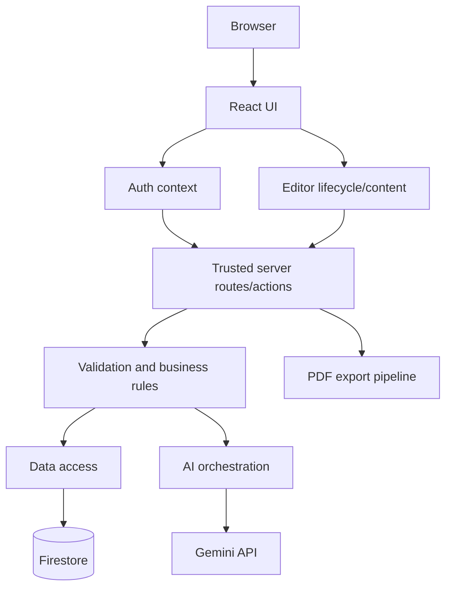

# TECHNICAL PLAN

**Project:** SyncSphere  
**Document Status:** Approved  
**Version:** 0.2  
**Document Type:** Technical Architecture & Implementation Plan  
**Approved By:** Evans Abraham (Project Owner)  
**Target Branch:** `agentic-development`  
**Parent Documents:** Project Charter v0.3 · Product Requirements v0.2 · Recovery Roadmap v0.2

---

## 1. Purpose and Objectives

This plan defines architecture, engineering constraints, and modernization approach for recovering SyncSphere. The product is to be incrementally improved—not rewritten. Objectives: secure auth/access boundaries, protect data, stabilize persistence/editor lifecycle, modernize runtime/framework, preserve existing features, improve responsive UX and PDF export, and establish trustworthy automated verification.

## 2. Current Baseline vs Approved Target

Current versions below reflect repository inspection and must be re-confirmed during M0 before implementation. Target versions are goals, not claims that upgrades are already installed.

| Component | Current Baseline | Approved Target |
|---|---|---|
| Runtime/CI | Node.js 20 in CI | Node.js 24 LTS |
| Framework | Next.js 14 / App Router | Next.js 16 / App Router |
| UI | React 18 | React 19 |
| Language | JavaScript, JSX, MJS | JavaScript/JSX retained |
| Package manager | npm | npm |
| Auth | Clerk | Clerk; compatibility update as needed |
| Data | Firebase / Firestore | Firebase / Firestore |
| Editor | Editor.js | Retain pending compatibility/maintenance assessment |
| AI | Gemini SDK | Gemini, server-side only |
| Styling | Tailwind CSS 3, Radix UI | Supported compatible versions, evaluated |
| Hosting | Vercel | Vercel, preview and deployment settings reviewed |
| Tests/lint | Not established | Appropriate tools, required checks |

No TypeScript migration is required. JS/JSX/MJS remains the canonical application language. TypeScript porting is P3/deferred and is not part of recovery acceptance.

## 3. Modernization Policy

- Confirm exact versions, scripts, peer dependencies, lockfile, and baseline health before upgrades.
- Prefer supported releases compatible with the approved target and existing product.
- Upgrade in bounded steps; avoid blanket updates.
- Review release notes, breaking changes, ecosystem maintenance, vulnerabilities, license, bundle/resource impact.
- Keep dependency and lockfile changes aligned.
- Verify clean install, build, tests, lint, critical journeys, and security after each meaningful step.
- Commit verified checkpoints and maintain a rollback/recovery path.
- Do not let framework migration delay urgent P0 security/data fixes.
- Obtain owner approval for material architectural changes or scope expansion.

## 4. Architecture

Maintain a modular Next.js application with logical boundaries, not independently deployed services by default.

### Layers

- **Presentation:** React components, navigation, local UI state, responsive layout, feedback.
- **Authentication/authorization:** Clerk identity; server-side resource ownership/membership checks.
- **Application logic:** workflows, validation, orchestration, error handling.
- **Data access:** Firestore operations, queries, data shape checks, controlled mutations.
- **Integrations:** Gemini, auth/data SDKs, export utilities.

Introduce boundaries only as part of scoped tasks; avoid wholesale restructuring.

## 5. Architectural Principles

1. Incremental recovery and functionality preservation.
2. Separation of concerns and maintainable JavaScript modules.
3. Security by default; trusted server-side enforcement.
4. Data integrity and content recovery.
5. Testable design and evidence-based decisions.
6. Simple solutions over overengineering or unnecessary services.
7. No unapproved destructive, production, or data migration actions.

## 6. Authentication and Authorization

Clerk remains the identity provider unless an issue warrants owner approval. Verify identity on trusted server operations. Authentication does not grant blanket access.

Protected operations must check workspace ownership/membership and document relationships for reads, creates, updates, and deletes, including AI context and PDF exports. Client-supplied IDs or hidden UI controls are not authorization. Deny by default if access cannot be established.

Firestore rules must be inspected and tested for authenticated access, ownership/membership, cross-workspace isolation, and permitted fields/operations. Server authorization and rules are complementary; verify actual deployed rules and SDK access model.

## 7. Firestore and Data Integrity

Document existing collection names, field shapes, relationships, and access paths before changing schema.

Requirements:
- Validate input and stored data shape.
- Prevent unauthorized access/mutation.
- Preserve unrelated fields/content.
- Avoid stale overwrites, duplicate operations, and orphaned records.
- Handle partial failures and destructive operations safely.
- Surface failures and preserve unsaved content.

Centralize reusable data operations where it improves testability and consistency. Avoid duplicated queries, unvalidated writes, implicit identity trust, swallowed failures, uncontrolled side effects, and coupling to editor lifecycle.

### Migration policy

Breaking data changes require documented rationale, compatibility analysis, representative tests, backup/rollback or recovery strategy where feasible, and owner approval before execution. This plan does not authorize destructive migrations.

## 8. Server/API Boundaries

Use Next.js route handlers, server actions, or server-only modules for trusted operations as appropriate. Keep entry points focused and validate at boundaries. Authenticate/authorize before protected work; return consistent safe errors; prevent duplicate/conflicting operations where needed. Avoid introducing a separate backend unless justified.

Client responsibilities: presentation, navigation, transient UI state, editor interaction, status display, and calling trusted boundaries. Client code is not authoritative for identity, permissions, secrets, or data integrity.

## 9. Gemini Integration

Gemini calls must be server-side. API keys remain server-only, never `NEXT_PUBLIC_*`, committed, returned to clients, or embedded in bundles.

AI request flow:
1. Receive user request.
2. Authenticate user.
3. Authorize any workspace/document context.
4. Validate and bound input.
5. Apply appropriate abuse/usage controls.
6. Call provider.
7. Validate response shape/content.
8. Return safe output for user review.

Treat AI output as untrusted. Handle timeouts, malformed/empty responses, provider errors, unsafe content, and excessive requests. Do not silently replace existing content. Include only necessary private context; avoid sensitive logging.

Rate-limit mechanism and thresholds remain subject to deployment/baseline evaluation.

## 10. Editor and Persistence

Editor.js remains the starting editor pending compatibility and maintenance assessment.

Lifecycle requirements: initialize only when ready; avoid duplicate instances; destroy on unmount/document change; clean up handlers/listeners; prevent stale editor instances; handle failures.

Maintain structured content compatible with existing data. Assess block/tool support, malformed content, unknown blocks, and conversion needs before migration.

Persistence must establish:
- Appropriate autosave/debounce or coordination.
- Explicit pending/saving/saved/failed state.
- Duplicate-write handling and stale-write protection.
- Document identity and navigation coordination.
- Safe retry and unsaved-content recovery.
- Behavior during navigation and failed writes.

Do not choose timing/intervals or concurrency mechanisms without baseline and tests. Failure must not be misrepresented as success or discard content silently.

Editor enhancements (formatting, lists, tables, links, images, code, alignment, shortcuts) follow PRD and roadmap; evaluate plugin compatibility before adoption.

## 11. Responsive UI and Accessibility

Build on existing Tailwind/Radix patterns. Prioritize mobile navigation, editor toolbar usability, touch targets, menus/dialogs, wide content, scrolling, orientation, and preserving desktop functionality.

Test representative widths: 320, 375, 430, 768, 1024, 1440px and above. Support keyboard navigation, semantic controls, accessible labels, focus handling, contrast, and understandable status/errors. Accessibility should be considered in component work, not deferred to a final cosmetic stage.

## 12. PDF Export

Export structured document content rather than editor screenshots. Aim for selectable text, preserved supported formatting, readable typography, independent viewport behavior, sensible pagination, no clipping, and robust handling of tables, images, code, long content, and unsupported blocks. A4 with reasonable margins is the initial default.

Library selection remains open pending evaluation of Editor.js data compatibility, Next.js/runtime constraints, deployment, quality, licensing, maintenance, and resource usage. No dependency is selected by this plan alone.

## 13. Testing Strategy

Testing tooling must be inventoried before adoption. Introduce small, maintainable tooling compatible with target stack.

- **Unit:** validators, business rules, transformations, AI parsing, utilities.
- **Integration:** Firestore/data access, routes/actions, auth boundaries, editor persistence, AI handling with controlled doubles.
- **Component:** loading/error/empty states, forms, dialogs, navigation, editor feedback.
- **End-to-end:** auth/access, workspace/document CRUD, edit/save/reload, AI generation, export, responsive workflows.

Prefer deterministic tests and avoid real credentials/production data. Tests accompany fixes and protect regressions.

## 14. CI and Engineering Workflow

CI target:
- Node.js 24.
- Clean reproducible install using `npm ci`.
- Required lint once configuration is established.
- Required tests once test framework/suite is established.
- Production build.
- Relevant security and regression checks.

Correct branch triggers and PR target to recovery branch. Preserve manual workflow dispatch where useful. Do not modify CI merely through this plan; workflow changes are separate scoped implementation work. Do not conceal or bypass failing checks.

Branch governance: `main` remains production-bound; `agentic-development` is recovery branch; feature branches may be used. No merge/deployment to production without explicit approval.

## 15. Environment and Secrets

Maintain consistent environment configuration for local, tests, CI, and deployment. Sample files use placeholders only. Confirm exact names/required variables through source inspection rather than inventing. Secrets are never committed, client-exposed, or logged. Invalid/missing config should fail clearly. Rotate credentials if exposure is confirmed through an authorized process.

## 16. Dependencies

npm is canonical; `package-lock.json` is reproducibility source; use `npm ci`. Evaluate maintenance, compatibility, security, license, resource/bundle cost before adding/upgrading. Avoid unrelated package churn or mass upgrades. Core framework/auth dependency changes require documented rationale and review.

## 17. Observability and Error Handling

Provide safe user errors, useful server diagnostics, distinguishable operational failures, and explicit save/AI statuses. Avoid logging secrets or sensitive document content. Evaluate existing platform capabilities before adding monitoring services.

## 18. Open Technical Decisions

| Decision | Direction / Status |
|---|---|
| Node / framework / React | Approved target: Node 24, Next.js 16, React 19; compatibility/migration verification pending |
| Language | JavaScript/JSX/MJS retained; TS migration deferred P3 |
| Auth | Clerk retained; audit |
| Data | Firestore retained; audit rules and model |
| Editor | Editor.js retained pending evaluation |
| AI | Gemini, server-side only |
| PDF library | Undecided; evaluate before adoption |
| Test tooling | Undecided until baseline inspection |
| Autosave/concurrency | Design and test during stability milestone |
| Rate limits | Required; mechanism/thresholds to be evaluated |
| CI | Node 24 and enforced checks target; implementation pending |
| Data migrations | Avoid; owner approval for breaking/destructive changes |

## 19. Constraints

- No wholesale rewrite or feature removal without approved justification.
- No production data experiments or destructive migration without approval.
- No client exposure or source-control secrets.
- No production deployment without explicit approval.
- No unverified claims about tests, security, build, or runtime.
- No unnecessary services/dependencies or scope expansion.
- Preserve existing documents/data and user workflows.

## 20. Technical Completion Criteria

Recovery is complete when architecture/boundaries are implemented and verified; auth/access and Firestore rules are tested; core CRUD and persistence are reliable; editor lifecycle/content compatibility is sound; AI is secured and validated; responsive usability and PDF export meet acceptance criteria; test/lint/build/CI are functioning; setup docs and risks are current; and Project Owner approves.

## 21. Plan Maintenance

Refine the plan based on evidence. Routine implementation choices within scope may be documented; material architecture, data, scope, cost, security, or feature changes require owner review.

---

**End of Technical Plan — Version 0.2 — Approved**
