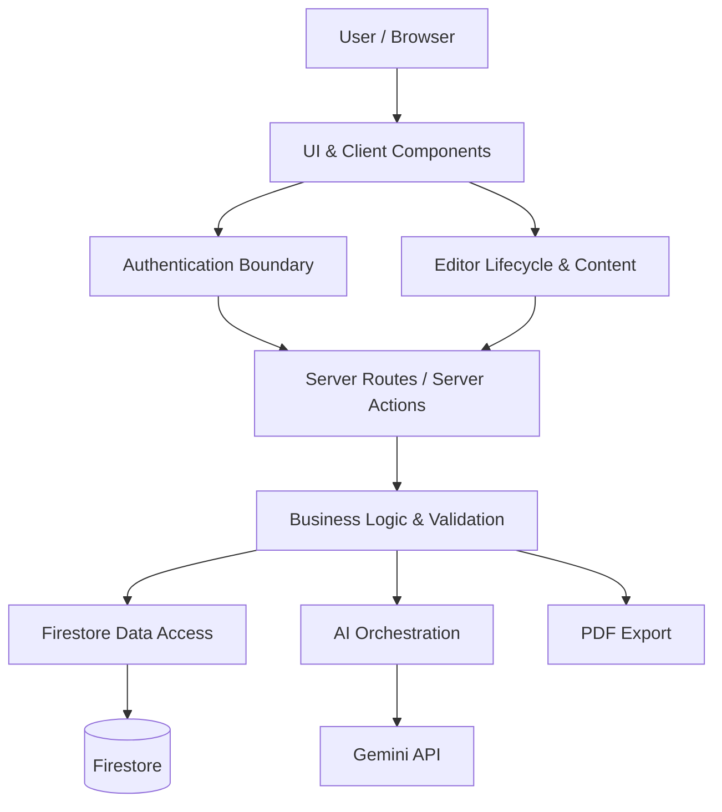
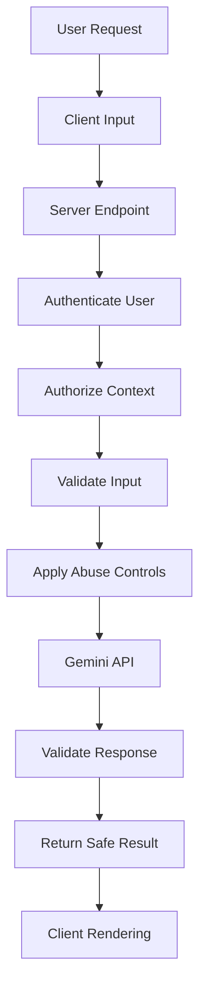

# TECHNICAL PLAN

**Project:** SyncSphere  
**Document Status:** Approved  
**Version:** 0.1  
**Document Type:** Technical Architecture & Implementation Plan  
**Approved By:** Evans Abraham (Project Owner)  
**Target Branch:** `agentic-development`  
**Parent Documents:** Project Charter v0.2 · Product Requirements v0.1 · Recovery Roadmap v0.1

---

## 1. Purpose

This document defines the technical direction, architectural boundaries, engineering constraints, and implementation approach for the recovery and modernization of SyncSphere.

The intent is to improve the existing application without unnecessary rewrites, protect user data, establish maintainable boundaries, and provide a reliable foundation for continued development.

This plan serves as the technical reference for implementation decisions throughout the recovery process.

### Objectives

- Stabilize the existing application architecture.
- Establish secure authentication and authorization boundaries.
- Protect workspace and document data integrity.
- Improve persistence and editor lifecycle reliability.
- Keep AI operations secure and server-side.
- Maintain a responsive and accessible user experience.
- Enable dependable document export.
- Introduce practical testing, CI, and verification standards.

---

## 2. Existing Technology Stack

The following stack has been identified during the initial static repository assessment. Actual versions, integration details, and runtime behavior must be confirmed during M0.

| Component | Technology |
|---|---|
| Framework | Next.js 14 |
| Application model | App Router |
| UI library | React 18 |
| Authentication | Clerk |
| Database | Firebase Firestore |
| Editor | Editor.js |
| AI integration | Gemini API |
| Styling | Tailwind CSS |
| Deployment platform | Vercel |
| Package manager | npm |

The existing stack is the starting point. Replacing a technology requires demonstrated technical necessity, documented impact, and owner approval where the change materially affects project scope or architecture.

---

## 3. Architectural Principles

### 3.1 Incremental Recovery

SyncSphere is an existing product. Engineering changes must target identified weaknesses and preserve working features.

### 3.2 Separation of Concerns

Components should have clearly defined responsibilities. UI rendering, business logic, persistence, authentication, validation, and AI orchestration should not become tightly coupled.

### 3.3 Security by Default

Authentication, authorization, validation, and secret management must be handled at trusted boundaries. Client-side checks alone are not security controls.

### 3.4 Data Integrity First

Document content must not silently disappear, become overwritten by stale operations, or be corrupted during editing, saving, deletion, or export.

### 3.5 Maintainability Over Cleverness

Prefer simple, understandable solutions with appropriate abstractions. Avoid overengineering, unnecessary dependencies, premature service separation, and abstractions without demonstrated value.

### 3.6 Testable Design

Core logic should be structured so it can be tested independently where practical, without requiring a browser or external service for every unit-level test.

---

## 4. System Architecture

### 4.1 Logical Architecture

SyncSphere should maintain clear logical boundaries within the existing Next.js application.

This diagram represents a proposed logical separation, not a requirement to create independent deployments, services, or packages.

### 4.2 Application Layers

**Presentation Layer**
- React components and pages.
- Client-side interaction and local UI state.
- Navigation, responsive layout, dialogs, menus, and editor controls.
- User-facing loading, error, and save-state feedback.

**Authentication & Authorization Layer**
- Authentication identity resolution through Clerk.
- Server-side authorization checks.
- Workspace membership/ownership and document access validation.
- Enforcement of resource access boundaries.

**Application / Business Logic Layer**
- Workspace and document operations.
- Input validation and workflow coordination.
- AI request orchestration.
- Persistence rules and error handling.
- Shared operations independent of UI rendering.

**Data Access Layer**
- Firestore operations.
- Query definitions.
- Data conversion and validation.
- Controlled database interaction and consistent error handling.

**Integration Layer**
- Gemini API communication.
- Authentication and database SDK integrations.
- Export utilities and any necessary external dependencies.

The boundaries should be introduced incrementally. Existing code may be reorganized only as part of a defined recovery task, not through a wholesale rewrite.

---

## 5. Authentication & Authorization

### 5.1 Authentication

Clerk remains the authentication provider unless assessment demonstrates a significant issue that requires owner approval to change.

Authentication must establish a trusted user identity on the server for protected operations.

### 5.2 Authorization

Authentication does not automatically grant access to all workspaces or documents.

Every protected operation must verify the requesting user's authorization for the target resource.

Authorization requirements include:

- Verify authenticated user identity server-side.
- Verify workspace ownership or membership.
- Verify document access within its parent workspace.
- Prevent access by manipulating client-supplied identifiers.
- Validate authorization on reads, writes, updates, and deletes.
- Avoid relying on hidden UI controls or client-only restrictions.
- Deny access by default if authorization cannot be established.

### 5.3 Access Control Enforcement

Access control must be consistently applied across:

- Workspace listing and retrieval.
- Workspace creation, modification, and deletion.
- Document listing and retrieval.
- Document creation, modification, and deletion.
- AI generation involving private workspace/document context.
- PDF export of protected documents.

### 5.4 Firestore Security Rules

Firestore rules must be inspected and verified during recovery.

The implementation must establish:

- Appropriate authenticated access requirements.
- Correct ownership/membership enforcement.
- Restriction of unauthorized reads and writes.
- Protection against cross-workspace access.
- Appropriate validation of permitted fields and operations.

Server-side authorization and Firestore rules should provide complementary security where applicable.

**Open investigation:** Confirm the active rules, their deployment status, the data model, and whether the application currently relies on client SDK access or server-mediated access.

---

## 6. Data Architecture & Firestore

### 6.1 Existing Data Model

The existing workspace/document structure must be inspected and documented before any changes are proposed.

The logical entities are expected to include:

- **Users** — identity references managed by the authentication provider.
- **Workspaces** — organizational containers and ownership/membership information.
- **Documents** — content, metadata, and parent-workspace relationships.

This is a logical description, not a proposal to change existing Firestore collection names or field structures.

### 6.2 Data Integrity Requirements

- Validate data before writing.
- Validate expected data shape when reading.
- Prevent unauthorized modification.
- Protect document content from stale overwrites.
- Handle failed writes without silently discarding user input.
- Maintain consistent relationships between workspaces and documents.
- Use safe deletion behavior and safeguards where appropriate.
- Handle partial failures explicitly.
- Avoid unnecessary writes and duplicate operations.

### 6.3 Data Access Strategy

Firestore interaction should be centralized where practical, with reusable and testable functions for core operations.

Data access code should avoid:

- Duplicated query and mutation logic across UI components.
- Unvalidated writes.
- Implicit reliance on client-provided identity.
- Uncontrolled side effects.
- Swallowing database failures.
- Unnecessary coupling to editor component lifecycle.

### 6.4 Data Migration Policy

Any breaking data-model change or migration requires:

1. Documented rationale.
2. Analysis of existing user data compatibility.
3. Defined migration and rollback/recovery strategy where feasible.
4. Tests against representative data.
5. Owner approval before execution.

No destructive data migration is authorized by this technical plan.

---

## 7. Backend & API Boundaries

### 7.1 Server Responsibilities

Trusted operations must be performed on the server where security or data integrity requires it.

Server-side boundaries should handle:

- Authentication and authorization.
- Input validation.
- Workspace/document mutations.
- Protected AI calls.
- Sensitive integration credentials.
- Business rules.
- Appropriate error handling.

### 7.2 API Design Principles

- Keep route handlers and server actions focused.
- Validate request data at entry points.
- Authenticate and authorize before protected work.
- Return consistent, understandable responses.
- Avoid exposing internal exceptions, secrets, or sensitive database details.
- Prevent duplicate or conflicting operations where necessary.
- Use appropriate status codes and error semantics.
- Avoid introducing a separate backend service unless a demonstrated requirement justifies it.

### 7.3 Client Responsibilities

The client should primarily handle:

- Presentation and navigation.
- User interaction.
- Local transient UI state.
- Editor interaction.
- Displaying save and operation status.
- Calling trusted server boundaries.
- Rendering validated responses.

The client must not be treated as a trusted source for ownership, permissions, secret values, or authoritative data.

---

## 8. AI Integration & Gemini

### 8.1 Security Boundary

Gemini API access must be server-side.

API credentials must:

- Remain in server-only environment configuration.
- Never use `NEXT_PUBLIC_` exposure.
- Never be committed to source control.
- Never be returned to the client.
- Be checked for accidental inclusion in client bundles during verification.

### 8.2 AI Request Flow

### 8.3 AI Reliability

AI responses must be treated as untrusted external output.

Implementation requirements:

- Validate request parameters and limits.
- Validate response structure and expected content.
- Handle empty, malformed, incomplete, or unexpected responses.
- Avoid unsafe rendering or execution of generated content.
- Handle provider errors and timeouts.
- Prevent unbounded or abusive requests.
- Provide clear failure feedback.
- Preserve existing user content when generation fails.

### 8.4 AI Context & Privacy

- Only include information necessary for the user's requested operation.
- Verify authorization before using workspace or document context.
- Do not expose private context to unauthorized users.
- Avoid logging sensitive document content or credentials unnecessarily.
- Keep AI generation separate from automatic destructive document changes.

AI-generated document content must not silently overwrite an existing document.

### 8.5 Rate Limiting & Abuse Prevention

The AI integration should have appropriate controls to reduce abuse, excessive usage, and unexpected cost.

The exact mechanism and thresholds remain open until the implementation and deployment environment are assessed.

---

## 9. Editor Architecture & Persistence

### 9.1 Editor Lifecycle

Editor.js is retained as the existing editor unless technical evaluation identifies a significant blocker.

The editor must have a controlled lifecycle:

- Initialize only when its container and required dependencies are available.
- Avoid duplicate instances.
- Cleanly destroy instances when the component unmounts or document changes.
- Correctly manage listeners and callbacks.
- Prevent stale editor instances from affecting another document.
- Handle initialization and teardown errors.

### 9.2 Document Content

Editor content should be maintained in a structured format compatible with the existing storage model and Editor.js output.

The recovery process must evaluate:

- Existing content compatibility.
- Block types and supported tools.
- Validation of saved content.
- Handling of missing or malformed blocks.
- Preservation of unknown or unsupported content where feasible.
- Content conversion only when justified and tested.

### 9.3 Persistence Strategy

Persistence must protect against content loss and stale writes.

The implementation should evaluate and establish:

- Appropriate autosave triggering.
- Debouncing or other write coordination.
- Save status: pending, saving, saved, or failed.
- Duplicate write prevention.
- Document identity and lifecycle coordination.
- Stale-write protection.
- Retry behavior where safe.
- Recovery of unsaved content after failure where feasible.
- Appropriate behavior when navigation occurs during saving.

Specific autosave intervals, mechanisms, and concurrency controls must be determined from the baseline and testing—not assumed in advance.

### 9.4 Save Failure Behavior

When saving fails:

- The user must receive clear feedback.
- Unsaved content should remain available in memory whenever feasible.
- A failure must not be silently represented as a successful save.
- Retrying must not create duplicate or conflicting content.
- The recovery path must be documented and tested.

### 9.5 Editor Features

The planned editor capability scope is governed by the PRD and Recovery Roadmap, including formatting, lists, tables, links, images, code, alignment, and usability improvements.

Tool availability and compatibility must be assessed before selecting new Editor.js plugins or dependencies.

---

## 10. Responsive UI & Accessibility

### 10.1 Responsive Strategy

Responsive improvements should build on the existing Tailwind-based UI.

Priorities:

- Mobile-first usability for critical flows.
- Workspace and document navigation that adapts to small screens.
- Accessible touch targets.
- Editor toolbar usability on mobile.
- Appropriate dialogs and menus.
- Responsive handling of tables and wide content.
- Reliable viewport and scrolling behavior.
- Preserve existing desktop functionality.

### 10.2 Verification Viewports

The recovery effort should test representative widths:

- 320px
- 375px
- 430px
- 768px
- 1024px
- 1440px and above

### 10.3 Accessibility

Where practical, maintain:

- Keyboard navigation.
- Semantic elements.
- Accessible labels.
- Focus handling in dialogs and menus.
- Appropriate color contrast.
- Understandable error and status messages.
- Reduced reliance on visual-only interaction.

Accessibility should be integrated into component improvements rather than postponed as a separate cosmetic pass.

---

## 11. PDF Export Architecture

### 11.1 Export Principles

PDF export should be based on structured document content rather than capturing a screenshot of the editor.

The output should be:

- Readable and consistent.
- Independent of browser viewport dimensions.
- Properly paginated.
- Free from clipped content.
- Searchable/selectable as text where feasible.
- Able to preserve supported formatting and embedded media.

### 11.2 Content Support

Export support should be evaluated for:

- Headings and paragraphs.
- Lists and checklists.
- Quotes.
- Code blocks.
- Tables.
- Links.
- Images.
- Separators and supported formatting.

Unsupported content must degrade gracefully rather than silently corrupting the output.

### 11.3 Layout

Default export settings should use A4 page size, sensible margins, and readable typography unless evaluation justifies another default.

Page-break handling, long tables, large images, code blocks, and multi-page content must be considered.

### 11.4 Implementation Decision

The PDF library and implementation approach remain undecided until a technical evaluation establishes compatibility with Editor.js structured data, Next.js, deployment constraints, output quality, licensing, maintenance, and resource usage.

No PDF dependency is approved for adoption by this document alone.

---

## 12. Testing Strategy

### 12.1 Testing Principles

- Tests should be introduced alongside recovery work.
- Core business logic should be independently testable where practical.
- Security boundaries must have explicit tests.
- Tests should be repeatable and deterministic.
- External services should not be required for every unit test.
- Regression tests must protect corrected behavior.
- Verification must be reported honestly.

### 12.2 Testing Layers

**Unit Tests**
- Validation.
- Business logic.
- Data conversion.
- AI response parsing.
- Utility functions.
- Error handling.

**Integration Tests**
- Firestore data access.
- API routes and server actions.
- Authentication/authorization boundaries.
- Editor persistence coordination.
- AI integration handling using controlled test doubles where appropriate.

**Component Tests**
- Loading, empty, success, and error states.
- Dialogs, forms, menus, and navigation.
- Editor controls and save feedback.

**End-to-End / Workflow Tests**
- Authentication and access.
- Workspace CRUD.
- Document CRUD.
- Editing and persistence.
- AI generation.
- PDF export.
- Responsive workflows.

### 12.3 Test Infrastructure

The existing repository's test tooling must first be inspected.

The test framework and supporting libraries should be selected only when needed, with minimal dependency footprint and compatibility evaluation.

Testing should avoid requiring real credentials or production user data.

---

## 13. CI & Engineering Workflow

### 13.1 Continuous Integration

CI should be established or repaired to provide reliable verification on pushes and pull requests where supported.

Expected checks:

- Dependency installation using `npm ci`.
- Linting.
- Automated tests.
- Production build.
- Relevant security or configuration checks as justified.

CI failures must not be concealed or bypassed without documented reason and approval where appropriate.

### 13.2 Branch Strategy

- `main` — production-bound branch.
- `agentic-development` — primary recovery and development branch.
- Feature branches — scoped work as necessary.

No production deployment or merge into `main` is permitted without explicit owner authorization.

### 13.3 Commits

Commits should be:

- Small and logically scoped.
- Meaningfully named.
- Associated with verified work.
- Free of credentials, local configuration, or generated clutter.

---

## 14. Environment & Configuration Management

### 14.1 Environment Variables

Environment configuration must be documented and consistent across:

- Local development.
- Test environments.
- CI.
- Deployment.

The environment sample file should contain safe placeholder values only.

### 14.2 Secrets

- Secrets must not be committed.
- Secrets must not be exposed in client-side bundles.
- Credentials must be rotated if compromise or exposure is confirmed and appropriate approval/access exists.
- Logs must not leak sensitive values.

### 14.3 Configuration Validation

Missing or invalid configuration should fail clearly and safely rather than produce unpredictable runtime behavior.

Actual variable names, requirements, and current inconsistencies must be established during baseline assessment.

---

## 15. Dependency Management

- npm is the canonical package manager.
- `package-lock.json` is the dependency source of reproducibility.
- Use `npm ci` for clean installs and CI.
- Avoid unnecessary dependencies.
- Inspect maintenance, compatibility, licensing, security, and resource impact before adding packages.
- Avoid broad dependency upgrades during unrelated recovery work.
- Changes to core framework or authentication dependencies require documented justification and approval where scope is material.

---

## 16. Observability & Error Handling

SyncSphere should provide enough diagnostic information to understand failures without exposing sensitive data.

### Expected Practices

- Clear client-facing error messages.
- Useful server-side diagnostics.
- No sensitive tokens, secrets, or private content in logs.
- Distinguishable operational failures.
- Appropriate error boundaries where applicable.
- Explicit save and AI operation status.
- Consistent failure handling across core workflows.

A dedicated observability platform is not required by default. Existing platform capabilities should be evaluated before introducing external services.

---

## 17. Security Verification

Security verification should cover:

- Authentication enforcement.
- Workspace/document authorization.
- Firestore access rules.
- Client bundle inspection for secrets.
- AI endpoint security.
- Input validation.
- AI response validation.
- Abuse/rate limiting.
- Sensitive error/log handling.
- Dependency and environment hygiene.

Security checks must be included in recovery acceptance criteria.

---

## 18. Technical Decision & Open Questions

The following decisions are deliberately not finalized until evidence is gathered:

| Topic | Current Direction | Status |
|---|---|---|
| Framework | Retain Next.js 14 | Confirm baseline compatibility |
| Auth provider | Retain Clerk | Audit integration |
| Database | Retain Firestore | Audit data model/rules |
| Editor | Retain Editor.js | Evaluate lifecycle and tool compatibility |
| AI | Gemini, server-side only | Secure implementation required |
| PDF library | Undecided | Technical evaluation needed |
| Test framework | Undecided | Inspect existing tooling first |
| Autosave mechanism | Undecided | Baseline, design, test |
| Rate limiting | Required for AI abuse control | Mechanism and limits undecided |
| CI provider/workflow | Inspect existing setup | Establish/repair as needed |
| Data migration | Avoid unless required | Owner approval for breaking/destructive changes |

These open questions should be resolved within the relevant Recovery Roadmap milestones and documented as implementation decisions where necessary.

---

## 19. Implementation Constraints

The following constraints govern technical work:

- No wholesale rewrite without approved justification.
- No removal of existing features without owner approval.
- No production data experiments.
- No destructive data migrations without explicit approval.
- No secrets in source control or client bundles.
- No production deployment without explicit approval.
- No unverified claims about testing, security, or runtime behavior.
- No unnecessary dependencies or services.
- No architectural expansion outside approved project scope.
- Preserve compatibility with existing documents and user data as a priority.

---

## 20. Technical Completion Criteria

The technical recovery is considered complete when:

- Architecture and critical boundaries are documented and implemented.
- Authentication and authorization are verified.
- Firestore access and security rules are reviewed and tested.
- Core workspace/document operations are stable.
- Editor lifecycle and persistence are dependable.
- Existing document compatibility is maintained.
- AI integration is secure and validated.
- Responsive usability is verified.
- PDF export meets acceptance criteria.
- Automated tests and CI checks are functioning.
- Build and lint results are verified.
- Environment and setup documentation are current.
- Known risks and limitations are disclosed.
- The project owner reviews and approves recovery completion.

---

## 21. Maintenance of This Plan

This Technical Plan may be refined as repository evidence, testing, and recovery work reveal implementation details.

Changes to technical mechanisms that remain within approved scope may be made with documented rationale.

Material architectural changes, breaking data changes, feature removal, new external cost, or substantial scope expansion require owner review and approval.

---

**End of Technical Plan — Version 0.1 — Approved**
