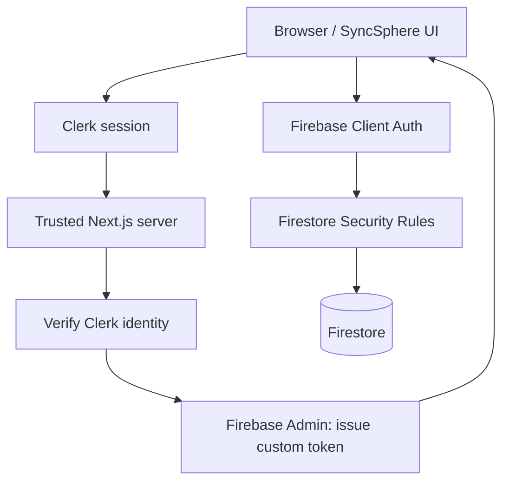

# ADR-001: Clerk Identity Bridge for Firebase Authentication

- **Status:** Accepted
- **Date:** 2026-11-28
- **Decision owner:** Project Owner
- **Project:** SyncSphere
- **Target branch:** `agentic-development`
- **Related documents:** `docs/TECHNICAL_PLAN.md`, `docs/BASELINE_ASSESSMENT.md`, `docs/RISK_REGISTER.md`

## Context

SyncSphere currently authenticates users with Clerk and initializes the Firebase client SDK for Firestore independently. Clerk protects application routes, but the client-side Firebase Firestore access model does not establish a Firebase Auth identity that Firestore Security Rules can use to enforce ownership and membership.

Client-side filters, email fields, workspace IDs, and organization IDs are not trusted authorization controls. The baseline Firestore rules were also found to permit unrestricted read and write access. The authorization recovery requires a verified identity that Firestore Rules can evaluate.

The recovery should secure the current application incrementally, preserving its existing Firebase/Firestore client workflows where practical, rather than requiring an immediate full server-only data-access rewrite.

## Decision

Adopt **Option A: Clerk-to-Firebase Authentication custom-token bridge**.

- Clerk remains the application identity provider.
- A trusted Next.js server boundary verifies the active Clerk session.
- The server derives the Firebase identity exclusively from the verified, stable Clerk user ID.
- Firebase Admin SDK issues a Firebase custom token for that UID.
- The browser exchanges the custom token using Firebase Client SDK Auth.
- Firestore client requests are authenticated by Firebase and must be authorized by Firestore Security Rules.
- Firebase UID is the Clerk user ID. Email is not used as the authorization identity.
- Organization context and workspace roles are separate from authentication identity and must be verified through a trusted authorization model.
- Firebase Admin is server-only. Its use to issue custom tokens does not authorize Admin SDK Firestore access to bypass Rules.

## Options considered

### Option A — Firebase Auth custom-token bridge (selected)

Clerk session is verified server-side, then a Firebase custom token is issued using the stable Clerk user ID. The existing Firestore client SDK can continue to make requests, now authenticated as that Firebase user, subject to Rules.

**Why selected:** Minimizes disruption to the current client-side Firestore architecture while enabling Firebase Rules to enforce authenticated ownership and membership. Provides an incremental path to trusted server operations without a wholesale rewrite.

### Option B — Server-only Firestore access through Next.js endpoints and Firebase Admin

All data access would be routed through authenticated server endpoints or server actions using Firebase Admin. This can centralize authorization and business logic, but requires a larger refactor of existing direct Firestore client operations. Admin SDK bypasses Firestore Security Rules, so each endpoint must perform explicit and complete authorization.

**Why not selected now:** Higher migration scope and maintenance burden for the current recovery. It may be revisited if the application’s needs or evidence justify it.

## Architecture

## Identity invariant

The Firebase UID must equal the verified Clerk user ID:

`Firebase UID = Clerk userId`

The client must never be able to select an arbitrary UID by supplying an email, user ID, organization ID, workspace ID, or document ID to the token-issuance endpoint.

Email changes must not alter ownership identity. Organization switching does not change the Firebase UID; organization membership and workspace authorization are checked separately.

## Security constraints

1. Verify Clerk sessions on the server for token issuance.
2. Reject unauthenticated requests.
3. Never trust client-supplied identity or permission claims.
4. Keep Firebase Admin and service credentials server-only.
5. Do not log custom tokens, secrets, or private document content.
6. Apply appropriate cache-control protections to token responses.
7. Evaluate CSRF/origin controls and abuse/rate limiting for the endpoint.
8. Keep Admin SDK Firestore access out of this bridge scope; Admin bypasses Rules.
9. Firestore Rules must default-deny and independently enforce ownership/membership and field constraints.
10. Do not activate strict production Rules until migration compatibility and verification are complete.

## Authorization model direction

Authentication is user-level. Authorization is resource-level.

- Personal workspaces are owned by a stable user UID.
- Organization workspaces require trusted organization context and membership verification.
- Workspace roles (owner/editor/viewer) are separate from identity.
- Membership provisioning must be trusted server-side; clients cannot grant themselves roles.
- Documents inherit access from their parent workspace, with rules validating the relationship and preventing path-based bypass.

The exact schema, role permissions, and Rules are to be finalized in a separate authorization design/implementation work package.

## Consequences

### Benefits

- Enables authenticated Firestore requests and Rules enforcement.
- Preserves much of the current client-side Firestore architecture.
- Uses a stable identity independent of email changes.
- Allows the authorization model and migration to be implemented in controlled stages.
- Avoids a full server-only Firestore rewrite at this point.

### Costs and risks

- SyncSphere must maintain Clerk and Firebase authentication lifecycle synchronization.
- Token issuance adds a trusted server endpoint and Admin SDK configuration.
- Auth-state races, account switching, failures, and retry behavior need explicit handling and tests.
- Existing data must be mapped to stable user IDs before strict Rules can safely be enforced.
- Organization and workspace membership remain a separate complex authorization problem.
- The custom-token bridge does not itself fix permissive Firestore Rules or authorize any data.

## Scope and rollout

This ADR approves the architectural direction only. It does **not** authorize:

- Production Firestore Rules changes or deployment.
- Data migration or destructive changes.
- Credential rotation or production environment changes.
- Production deployment.
- Implementation beyond separately approved, scoped tasks.

Implementation will proceed on `agentic-development` in reviewed checkpoints:

1. **M1.2.1:** Bridge specification and compatibility review.
2. **Stage A:** Admin/client Auth initialization and dependency/configuration.
3. **Stage B:** Clerk-verified custom-token endpoint.
4. **Stage C:** Client auth lifecycle synchronization.
5. **Stage D:** App integration and regression validation.
6. **Stage E:** Bridge acceptance, review, and owner approval.

Strict Rules, authorization schema, migration rehearsal, enforcement, and rollout are separate milestones with their own acceptance gates.

## Revisit conditions

Reconsider this decision if a full server-only data-access architecture becomes warranted, if the bridge materially increases complexity or operational risk, if Firebase Auth/Rules cannot adequately express the authorization requirements, or if new product requirements make the selected approach unsuitable.

---

**Decision:** Option A is accepted for SyncSphere's recovery architecture. Implementation and production enforcement remain subject to their respective scoped approvals and verification.
